# Agentic Presentation System — Complete Architecture

> **Paradigm Shift:** Passive Responder (text dump) → Active Presenter (knowledge graph + voice-driven visual narrative)

This document constitutes an exhaustive architectural exposition of the Agentic Presentation System — a sophisticated, multi-agent orchestration platform that transmutes arbitrary pedagogical subject matter into dynamically constructed, voice-narrated, visually-animated knowledge graph presentations with real-time adaptive reinforcement learning scaffolding.

---

## Table of Contents

1. [System Synopsis](#1-system-synopsis)
2. [High-Level Architecture](#2-high-level-architecture)
3. [Technology Stack](#3-technology-stack)
4. [Directory Topology](#4-directory-topology)
5. [Shared Type System (Data Contracts)](#5-shared-type-system-data-contracts)
6. [Backend Architecture](#6-backend-architecture)
   - 6.1 [Entry Point & Server Initialization](#61-entry-point--server-initialization)
   - 6.2 [WebSocket Gateway (Real-Time Orchestrator)](#62-websocket-gateway-real-time-orchestrator)
   - 6.3 [Agent Service (Claude AI Reasoning)](#63-agent-service-claude-ai-reasoning)
   - 6.4 [Multi-Agent Orchestrator](#64-multi-agent-orchestrator)
   - 6.5 [Knowledge Graph Service](#65-knowledge-graph-service)
   - 6.6 [Voice Service (STT/TTS Pipeline)](#66-voice-service-stttts-pipeline)
   - 6.7 [Presentation Planner](#67-presentation-planner)
   - 6.8 [Interrupt Handler](#68-interrupt-handler)
   - 6.9 [Reinforcement Learning Service](#69-reinforcement-learning-service)
   - 6.10 [Visual Script Generator](#610-visual-script-generator)
   - 6.11 [Scene Pipeline Orchestrator](#611-scene-pipeline-orchestrator)
   - 6.12 [Concurrency Pool](#612-concurrency-pool)
   - 6.13 [Domain Expert Service](#613-domain-expert-service)
   - 6.14 [Quality Critic Service](#614-quality-critic-service)
   - 6.15 [Layout Engine & Scene Composition](#615-layout-engine--scene-composition)
   - 6.16 [Auxiliary Services](#616-auxiliary-services)
   - 6.17 [REST API Routes](#617-rest-api-routes)
   - 6.18 [System Prompts](#618-system-prompts)
7. [Frontend Architecture](#7-frontend-architecture)
   - 7.1 [Application Shell (App.tsx)](#71-application-shell-apptsx)
   - 7.2 [State Management (Zustand Store)](#72-state-management-zustand-store)
   - 7.3 [Scene Presenter & Canvas Rendering](#73-scene-presenter--canvas-rendering)
   - 7.4 [SVG Entity Library](#74-svg-entity-library)
   - 7.5 [Audio Subsystem](#75-audio-subsystem)
   - 7.6 [Subtitle Synchronization](#76-subtitle-synchronization)
   - 7.7 [Demo Mode](#77-demo-mode)
8. [Core Data Pipelines](#8-core-data-pipelines)
   - 8.1 [Session Lifecycle Pipeline](#81-session-lifecycle-pipeline)
   - 8.2 [Concurrent Scene Preparation Pipeline](#82-concurrent-scene-preparation-pipeline)
   - 8.3 [Interrupt Protocol (5-Step)](#83-interrupt-protocol-5-step)
   - 8.4 [Reinforcement Learning Feedback Loop](#84-reinforcement-learning-feedback-loop)
9. [Multi-Agent Coordination Pattern](#9-multi-agent-coordination-pattern)
10. [Infrastructure & Deployment](#10-infrastructure--deployment)
11. [Performance Targets & Constants](#11-performance-targets--constants)
12. [Cross-Session Memory & Spaced Repetition](#12-cross-session-memory--spaced-repetition)

---

## 1. System Synopsis

The Agentic Presentation System transforms a user's natural-language topic inquiry into a fully orchestrated, voice-narrated, visually-animated pedagogical presentation. Rather than merely generating static text, the system constructs a **live knowledge graph**, decomposes it into a **scene sequence**, synthesizes **synchronized narration audio**, and renders **frame-by-frame visual narratives** — all while adapting its pedagogical strategy via **contextual bandit reinforcement learning** based on real-time learner engagement signals.

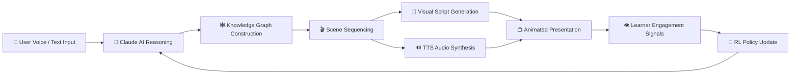

---

## 2. High-Level Architecture

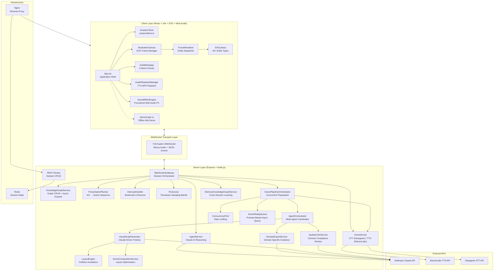

---

## 3. Technology Stack

| Layer | Technology | Purpose |
|-------|-----------|---------|
| **Frontend Framework** | React 18.2 + TypeScript 5.3 | Component-based UI with strict type safety |
| **State Management** | Zustand 4.4 + Immer 10 | Centralized immutable state with surgical updates |
| **Visualization** | SVG + D3-Force 3 | Force-directed graph layout + 40+ custom entity renderers |
| **Mathematics** | KaTeX 0.16 | LaTeX equation rendering inside SVG foreignObject |
| **Audio** | Web Audio API | Procedural sound effects + TTS playback with word-sync |
| **Build Tool** | Vite 5 | Fast HMR development + optimized production builds |
| **Backend Runtime** | Node.js 20 + Express 4.18 | REST API + WebSocket server |
| **WebSocket** | ws 8.16 | Full-duplex binary + JSON communication |
| **AI Engine** | Anthropic Claude (claude-sonnet-4-5) | Reasoning, classification, visual script generation |
| **Speech-to-Text** | Deepgram (nova-2 model) | Real-time audio transcription |
| **Text-to-Speech** | ElevenLabs (with_timestamps) | Voice synthesis with character-level alignment |
| **Database** | Redis (ioredis 5.3) | Session state persistence |
| **Graph Database** | Neo4j Driver 5.15 | Knowledge graph persistence (planned) |
| **Containerization** | Docker + Docker Compose | Multi-service orchestration |
| **Reverse Proxy** | Nginx (Alpine) | SPA serving + API/WS proxying |

---

## 4. Directory Topology

```
agentic-presentation-system/
├── shared/
│   └── types.ts                          # ★ Single source of truth for ALL type definitions
│
├── backend/
│   ├── src/
│   │   ├── index.ts                      # Express + WebSocket server entry point
│   │   ├── websocket/
│   │   │   └── gateway.ts                # Full-duplex session orchestrator
│   │   ├── services/
│   │   │   ├── AgentService.ts           # Claude AI reasoning + classification
│   │   │   ├── AgentOrchestrator.ts      # Multi-agent scene coordination
│   │   │   ├── KnowledgeGraphService.ts  # Graph CRUD + async expansion
│   │   │   ├── MemoryKnowledgeGraphService.ts  # Cross-session learning memory
│   │   │   ├── VoiceService.ts           # STT/TTS + intent classification
│   │   │   ├── PresentationPlanner.ts    # KG → scene sequence
│   │   │   ├── InterruptHandler.ts       # Bookmark + resume protocol
│   │   │   ├── RLService.ts             # Contextual bandit (Thompson Sampling)
│   │   │   ├── VisualScriptGenerator.ts  # Frame-by-frame visual narratives
│   │   │   ├── ScenePipelineOrchestrator.ts  # Concurrent scene preparation
│   │   │   ├── SceneReadyQueue.ts        # Promise-based async scene queue
│   │   │   ├── ConcurrencyPool.ts        # API rate-limit enforcement
│   │   │   ├── DomainExpertService.ts    # Domain-specific visual guidance
│   │   │   ├── QualityCriticService.ts   # Contract compliance review
│   │   │   ├── LayoutEngine.ts           # Collision avoidance
│   │   │   ├── SceneCompositionService.ts  # Layout optimization
│   │   │   ├── CodeExecutionService.ts   # Sandboxed code execution
│   │   │   ├── DataVisualizationService.ts # Chart generation
│   │   │   ├── AIIllustrationService.ts  # AI image generation
│   │   │   ├── MathVisualizationService.ts # LaTeX + plotting
│   │   │   ├── AdvancedAnimationService.ts # Particle/spring/cinematic animations
│   │   │   ├── AdvancedAudioService.ts   # Spatial audio + soundscapes
│   │   │   ├── Interactive3DService.ts   # Three.js 3D visualization
│   │   │   ├── LiveSystemIntegrationService.ts  # K8s/AWS/GCP live data
│   │   │   ├── LiveWebContentService.ts  # Web embedding + API playground
│   │   │   ├── MultimodalInputService.ts # Image/sketch/PDF analysis
│   │   │   ├── CollaborativeRecordingService.ts # Multi-user + recording
│   │   │   ├── AssetGenerationService.ts # Logo/icon asset library
│   │   │   └── VisualAdaptationService.ts # Learner-adaptive visuals
│   │   ├── routes/
│   │   │   └── sessions.ts              # REST: session/user CRUD
│   │   └── prompts/
│   │       ├── systemPrompts.ts          # Claude reasoning/interrupt prompts
│   │       └── presentationEnvironmentGuide.ts  # SVG canvas spec
│   ├── Dockerfile
│   ├── package.json
│   └── tsconfig.json
│
├── frontend/
│   ├── src/
│   │   ├── main.tsx                      # React bootstrap + KaTeX registration
│   │   ├── App.tsx                       # Main app: canvas, sidebar, timeline
│   │   ├── stores/
│   │   │   └── sessionStore.ts           # Zustand: unified state management
│   │   ├── components/
│   │   │   ├── ScenePresenter.tsx         # Scene canvas container
│   │   │   ├── IllustrationCanvas.tsx     # SVG frame manager + transitions
│   │   │   ├── FrameRenderer.tsx          # Entity rendering engine
│   │   │   ├── IllustrationElement.tsx    # Legacy element renderer
│   │   │   ├── IllustrationLayer.tsx      # Timing-based visibility filter
│   │   │   ├── SubtitleDisplay.tsx        # Word-synchronized subtitles
│   │   │   ├── ErrorBoundary.tsx          # Error handling wrapper
│   │   │   └── svg/
│   │   │       └── SVGLibrary.tsx         # 40+ SVG entity components
│   │   ├── audio/
│   │   │   ├── AudioPlaybackManager.ts   # TTS MP3 decode + playback
│   │   │   ├── SoundEffectEngine.ts      # Procedural Web Audio FX
│   │   │   └── SoundEffects.ts           # Legacy sound effects
│   │   ├── utils/
│   │   │   └── subtitleChunking.ts       # Word → 5-word chunk conversion
│   │   ├── demo/
│   │   │   └── demoGraph.ts              # Embedded K8s demo data
│   │   └── styles.css                    # Global design system
│   ├── Dockerfile
│   ├── nginx.conf
│   ├── vite.config.ts
│   └── package.json
│
├── docs/                                 # Implementation documentation
├── docker-compose.yml                    # Multi-service orchestration
├── .env.example                          # Environment variable template
└── CLAUDE.md                             # AI development guidelines
```

---

## 5. Shared Type System (Data Contracts)

All inter-service communication adheres to a **unified type contract** defined in `shared/types.ts`. This file is the canonical, authoritative source for every data structure traversing the system — from knowledge graph nodes through WebSocket event payloads to reinforcement learning state vectors.

### 5.1 Knowledge Graph Primitives

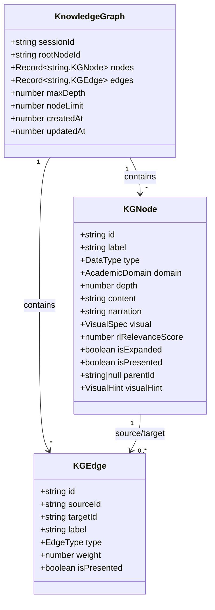

### 5.2 Data Type Classification (8 Semantic Types)

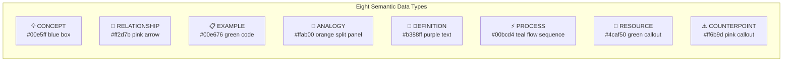

### 5.3 Session State Machine

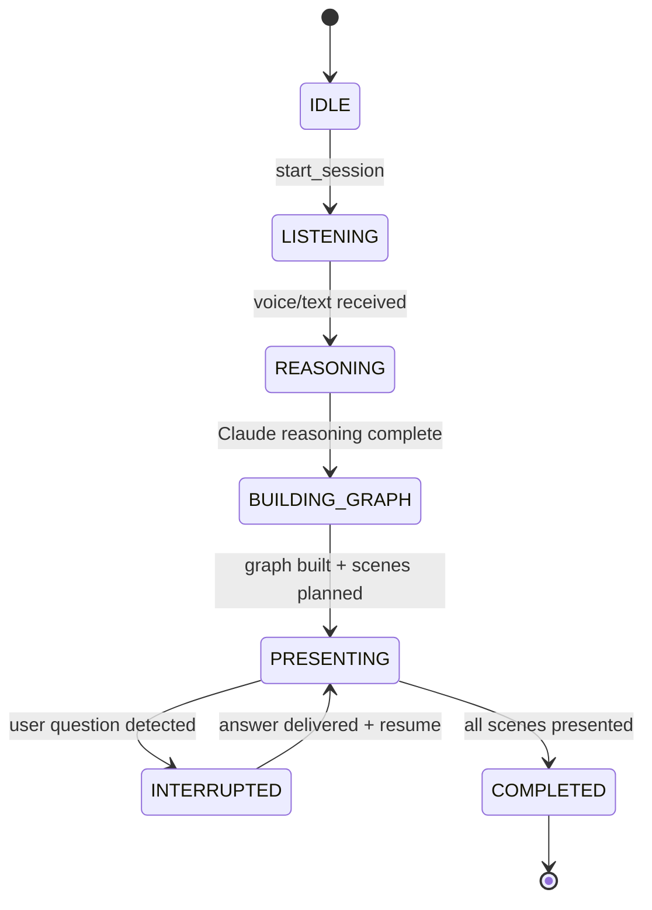

### 5.4 WebSocket Event Protocol

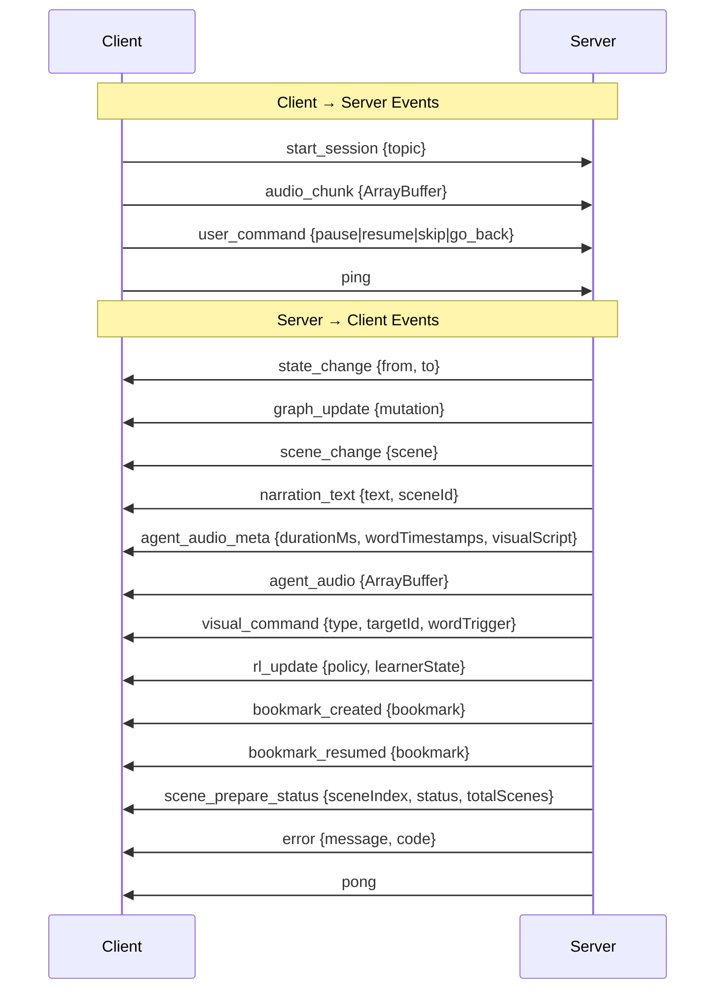

### 5.5 Frame-Based Visual Narrative System

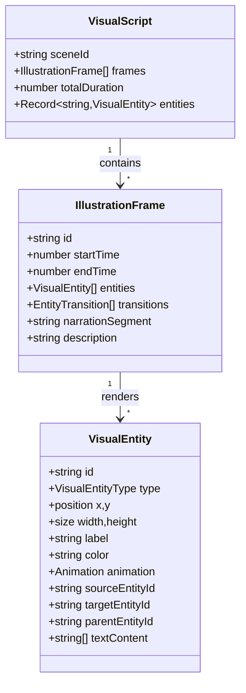

---

## 6. Backend Architecture

### 6.1 Entry Point & Server Initialization

`backend/src/index.ts` bootstraps an Express HTTP server augmented with WebSocket upgrade capability. It exposes a health-check endpoint at `/health`, mounts the REST session router at `/api`, and initializes the `WebSocketGateway` on the `/ws` path. The server listens on the port specified by the `PORT` environment variable (defaulting to 4000).

### 6.2 WebSocket Gateway (Real-Time Orchestrator)

`backend/src/websocket/gateway.ts` — **Class: `WebSocketGateway`**

The gateway is the **central nervous system** of the entire backend. It maintains per-session state, routes incoming WebSocket messages, and orchestrates the complete presentation lifecycle.

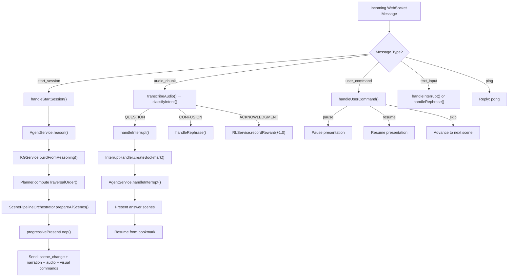

**Key Responsibilities:**

- **Session lifecycle management** across the full state machine (IDLE → PRESENTING → COMPLETED)
- **Progressive presentation loop** that consumes scenes from `SceneReadyQueue` as they become available
- **Visual script temporal rescaling** to match real TTS audio duration (animation timings adjusted dynamically)
- **Interrupt coordination** implementing the full 5-step bookmark/resume protocol
- **RL reward emission** based on detected learner engagement signals

### 6.3 Agent Service (Claude AI Reasoning)

`backend/src/services/AgentService.ts` — **Class: `AgentService`**

The intellectual core of the system. This service interfaces directly with the Anthropic Claude API to perform conceptual decomposition, interrupt reasoning, and alternate explanation generation.

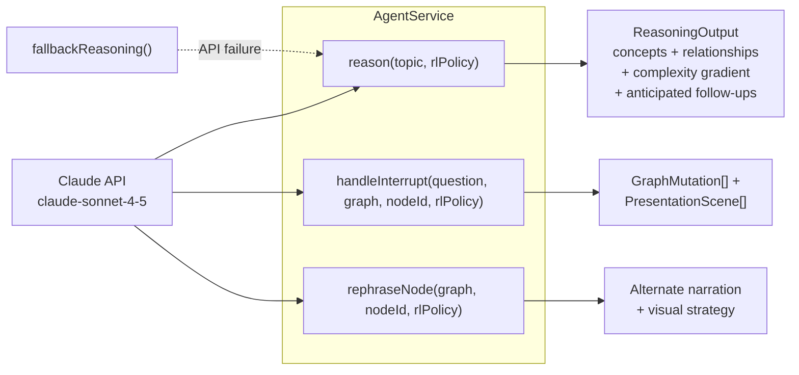

**Operations:**

- **`reason(topic, rlPolicy)`** — Decomposes a topic into conceptual primitives (nodes), relationships (edges), prerequisite dependencies, a complexity gradient, and anticipated follow-up questions. Output includes `VisualHint` and `SceneContract` for multi-agent orchestration.
- **`handleInterrupt(question, graph, currentNodeId, rlPolicy)`** — Reasons about a user's question in the context of the current knowledge graph state, producing graph mutations (new nodes/edges) and answer scenes.
- **`rephraseNode(graph, nodeId, rlPolicy)`** — Generates an alternate explanation for a node using a different pedagogical strategy (e.g., switch from definition-first to analogy-first).

### 6.4 Multi-Agent Orchestrator

`backend/src/services/AgentOrchestrator.ts` — **Class: `AgentOrchestrator`**

Implements the **Phase 2.5 multi-agent coordination pattern** using a blackboard architecture. Four specialized agents collaborate to produce each visual script.

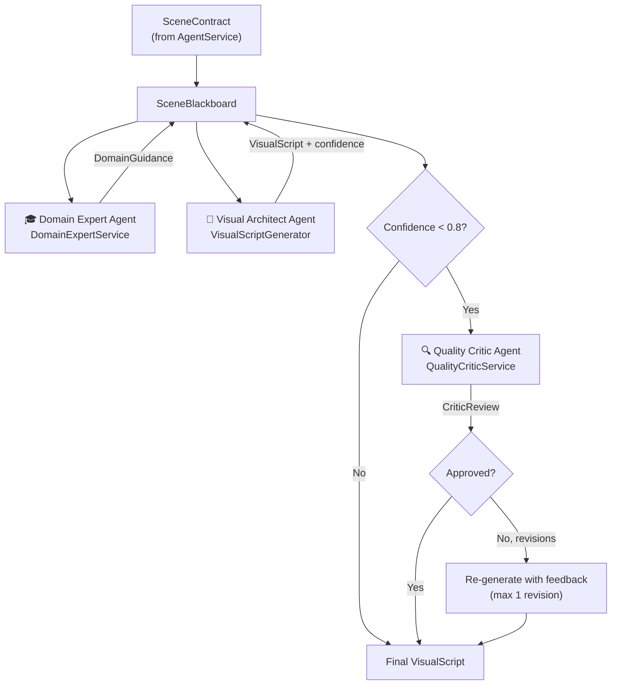

**Blackboard Pattern:** All agents read from and write to a shared `SceneBlackboard` object, enabling asynchronous, loosely-coupled collaboration with a unified state representation.

### 6.5 Knowledge Graph Service

`backend/src/services/KnowledgeGraphService.ts` — **Class: `KnowledgeGraphService`**

Responsible for **two-phase knowledge graph construction**: synchronous core building and asynchronous background expansion.

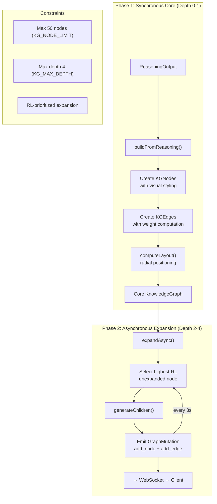

**Node Expansion Rules (type-specific):**

- **CONCEPT** → generates DEFINITION child + EXAMPLE child
- **PROCESS** → generates internal step nodes
- **DEFINITION** → generates misconception/counterpoint
- **EXAMPLE** → generates related example variant
- **ANALOGY** → generates mapped comparison

### 6.6 Voice Service (STT/TTS Pipeline)

`backend/src/services/VoiceService.ts` — **Class: `VoiceService`**

Manages the bidirectional voice pipeline: Speech-to-Text for user input and Text-to-Speech for narration output, with intent classification for engagement signal detection.

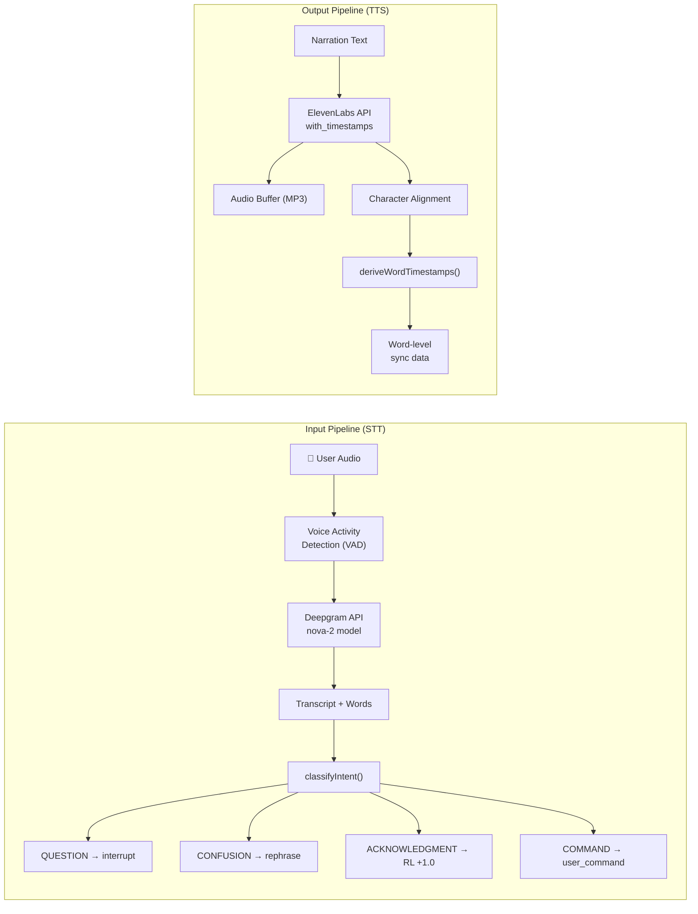

**VAD Configuration:** 16000 Hz sample rate, 30ms frame size, 800ms silence threshold, 200ms speech threshold.

### 6.7 Presentation Planner

`backend/src/services/PresentationPlanner.ts` — **Class: `PresentationPlanner`**

Transforms the knowledge graph into a **linear scene sequence** optimized for pedagogical progression.

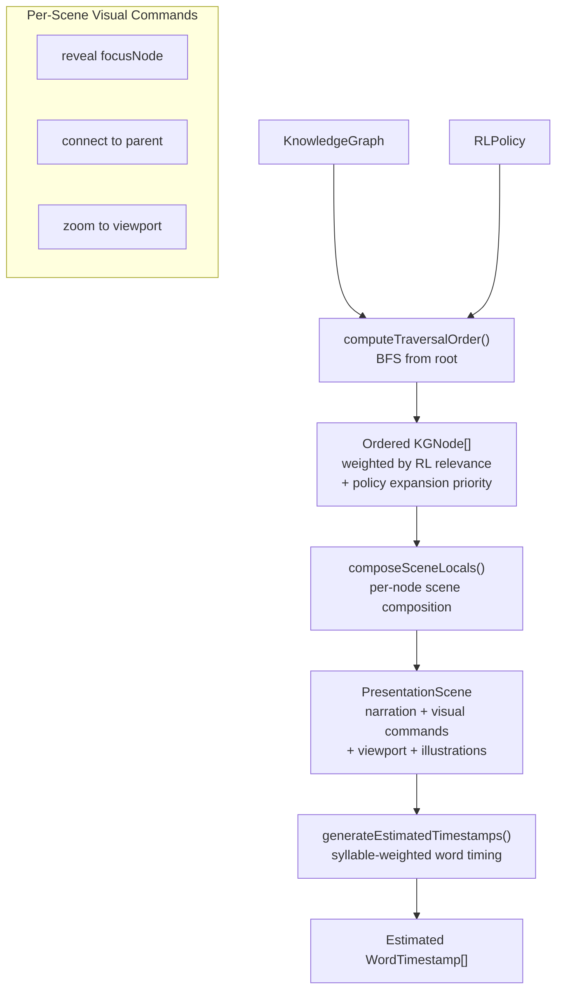

**Traversal scoring:** Each node receives a composite score from BFS distance (closer = higher), RL relevance score (from bandit), and policy expansion priority (data-type ordering). Only nodes at depth ≤ 2 are included in the initial presentation.

### 6.8 Interrupt Handler

`backend/src/services/InterruptHandler.ts` — **Class: `InterruptHandler`**

Implements the stateful bookmark/resume mechanism that enables seamless mid-presentation interruptions.

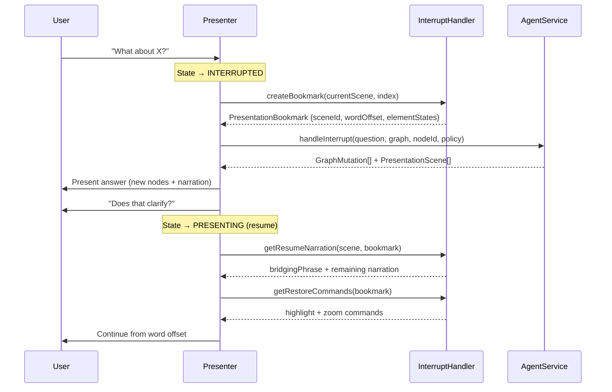

### 6.9 Reinforcement Learning Service

`backend/src/services/RLService.ts` — **Class: `RLService`**

Implements a **Contextual Bandit with Thompson Sampling** for real-time pedagogical strategy adaptation.

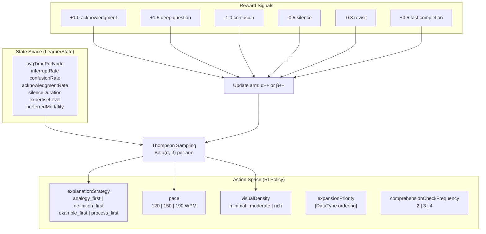

**Thompson Sampling Implementation:**

- Each arm (strategy, pace, density) maintains a Beta distribution parameterized by (α, β)
- Positive rewards increment α; negative rewards increment β
- At each decision point, a random sample is drawn from each arm's Beta distribution, and the arm with the highest sample is selected
- Beta sampling uses Jöhnk's algorithm; Gamma sampling uses Marsaglia & Tsang's method

### 6.10 Visual Script Generator

`backend/src/services/VisualScriptGenerator.ts` — **Class: `VisualScriptGenerator`**

The **visual narrative architect**. Uses Claude to decompose narration into semantically-segmented frames, map concepts to visual entities, choreograph animations, and enforce timing constraints.

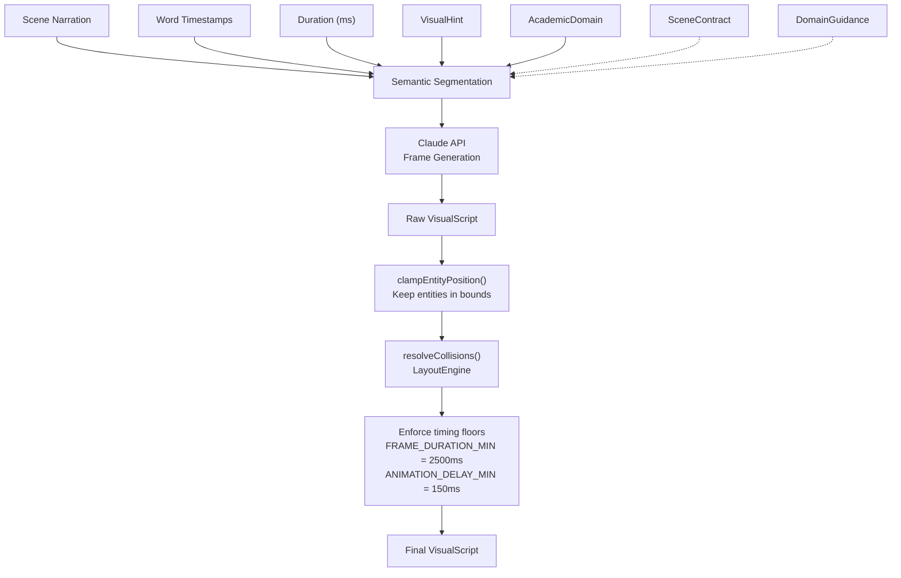

**Supports integration with auxiliary services:**

- `CodeExecutionService` — for code block visualization
- `DataVisualizationService` — for chart rendering
- `MathVisualizationService` — for LaTeX + function plotting
- `AIIllustrationService` — for custom AI-generated illustrations

### 6.11 Scene Pipeline Orchestrator

`backend/src/services/ScenePipelineOrchestrator.ts` — **Class: `ScenePipelineOrchestrator`**

Orchestrates **concurrent scene preparation** — visual script generation and TTS synthesis run in parallel for all scenes, with results fed into a `SceneReadyQueue` for progressive consumption.

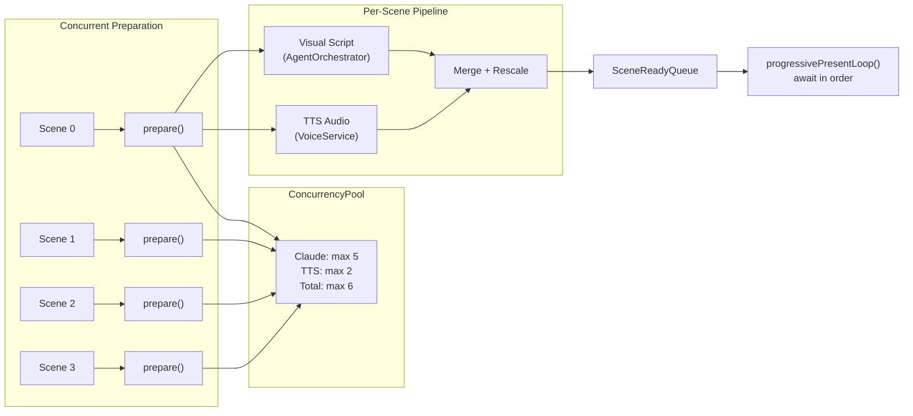

**Progressive Presentation:** The presentation loop does not wait for all scenes to complete. It starts presenting Scene 0 as soon as it is ready, then awaits Scene 1, etc. This dramatically reduces perceived latency.

### 6.12 Concurrency Pool

`backend/src/services/ConcurrencyPool.ts` — **Class: `ConcurrencyPool`**

Bounded async task executor preventing API rate-limit violations. Maintains separate slot limits for Claude API calls and TTS endpoint calls, plus a global total cap.

| Limit | Value | Constant |
|-------|-------|----------|
| Claude concurrent | 5 | `CONCURRENCY_POOL_CLAUDE_MAX` |
| TTS concurrent | 2 | `CONCURRENCY_POOL_TTS_MAX` |
| Total concurrent | 6 | `CONCURRENCY_POOL_TOTAL_MAX` |

### 6.13 Domain Expert Service

`backend/src/services/DomainExpertService.ts` — **Class: `DomainExpertService`**

Phase 2.5 multi-agent specialist that provides **domain-specific visual guidance** for academic subjects.

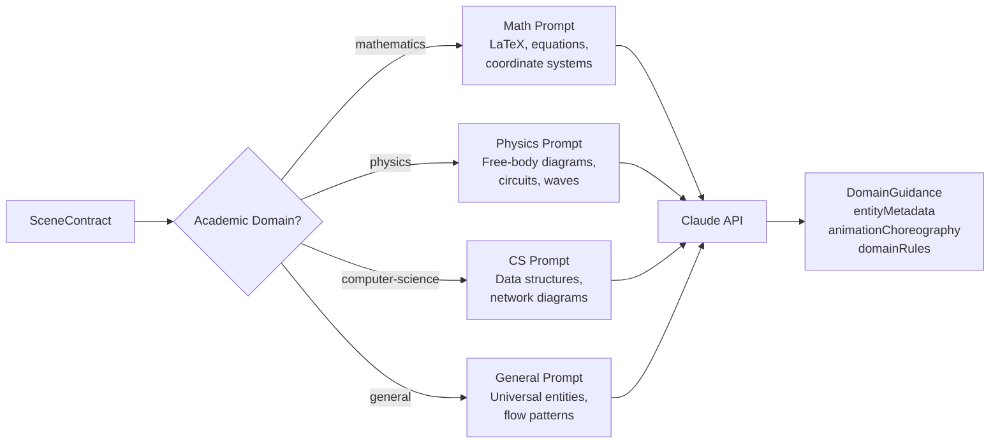

### 6.14 Quality Critic Service

`backend/src/services/QualityCriticService.ts` — **Class: `QualityCriticService`**

Reviews visual scripts against their scene contracts for **compliance, domain correctness, visual quality, and pedagogical alignment**.

**Evaluation Dimensions:**

- **Contract Compliance** — All required entities present? Spatial constraints satisfied?
- **Domain Correctness** — LaTeX balanced? Angles valid? Values reasonable?
- **Visual Quality** — No overlaps? Animation stagger applied? Variety in entity types?
- **Pedagogical Alignment** — Primary entity prominent? Narration reflected visually?

Returns a `CriticReview` with an approval boolean, quality score (0-1), and optional revision list with priority levels.

### 6.15 Layout Engine & Scene Composition

**LayoutEngine** (`LayoutEngine.ts`): Provides `resolveCollisions()` (iterative force-based repulsion) and `postProcessFrames()` (per-frame layout enforcement + collision avoidance).

**SceneCompositionService** (`SceneCompositionService.ts`): Offers five layout algorithms — force-directed, hierarchical, circular, grid, and flow — plus an aesthetic scoring function based on rule-of-thirds, golden ratio, and visual balance.

### 6.16 Auxiliary Services

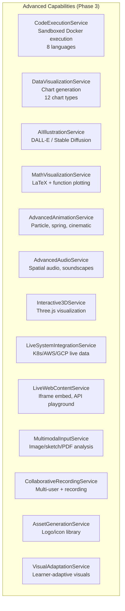

### 6.17 REST API Routes

`backend/src/routes/sessions.ts` — **Module: `sessionRouter`**

| Method | Endpoint | Description |
|--------|----------|-------------|
| `POST` | `/api/sessions` | Create session: `{topic, userId}` → `{sessionId, state, wsUrl}` |
| `GET` | `/api/sessions/:id` | Retrieve session state |
| `GET` | `/api/sessions/:id/graph` | Retrieve full knowledge graph |
| `GET` | `/api/users/:id/profile` | Retrieve RL learner profile |
| `PUT` | `/api/users/:id/preferences` | Update user preferences |
| `GET` | `/api/users/:id/sessions` | List session history |

### 6.18 System Prompts

**`REASONING_SYSTEM_PROMPT`** — Extensive Claude prompt defining the knowledge architect role with JSON schema for `ReasoningOutput`, visual entity type catalog, domain classification rules, and content structure guidelines.

**`INTERRUPT_SYSTEM_PROMPT`** — Contextual question reasoning prompt for producing graph mutations and answer scenes.

**`presentationEnvironmentGuide`** — SVG canvas specification, coordinate system, entity rendering guidelines.

---

## 7. Frontend Architecture

### 7.1 Application Shell (App.tsx)

The main React component orchestrating the entire client-side experience.

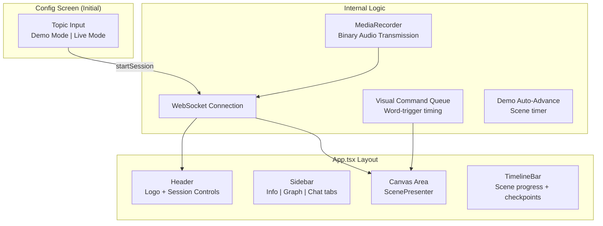

### 7.2 State Management (Zustand Store)

`frontend/src/stores/sessionStore.ts` — A single Zustand store using Immer for immutable state updates.

```mermaid
flowchart TB
    subgraph "Zustand Store Slices"
        SESSION["Session State<br/>sessionId, state machine,<br/>topic, connection status"]
        GRAPH["Knowledge Graph<br/>nodes, edges,<br/>rootNodeId"]
        SCENES["Presentation<br/>currentScene, sceneHistory,<br/>traversalPath"]
        AUDIO_STATE["Audio State<br/>currentAudioTime, voiceEnabled,<br/>isSpeaking, wordTimestamps"]
        VISUALS["Visual State<br/>visualCommandQueue, activeVisuals,<br/>viewport, zoom"]
        RL_STATE["RL State<br/>rlPolicy, learnerState"]
        CHAT["Chat<br/>messages[], chatInput"]
    end

    WS_MSG["WebSocket Messages"] -->|graph_update| GRAPH
    WS_MSG -->|scene_change| SCENES
    WS_MSG -->|visual_command| VISUALS
    WS_MSG -->|narration_text| AUDIO_STATE
    WS_MSG -->|rl_update| RL_STATE
    WS_MSG -->|state_change| SESSION
    WS_MSG -->|agent_audio_meta| AUDIO_STATE

    GRAPH & SCENES & AUDIO_STATE & VISUALS --> RENDER["React Re-render"]
```

**Reconnection:** Exponential backoff (1s → 2s → 4s → ... → 30s max) with automatic state recovery.

### 7.3 Scene Presenter & Canvas Rendering

```mermaid
flowchart TB
    SP["ScenePresenter.tsx"] --> IC["IllustrationCanvas.tsx<br/>SVG container 1600×900"]
    SP --> SD["SubtitleDisplay.tsx<br/>5-word synchronized chunks"]

    IC --> FR["FrameRenderer.tsx<br/>Entity dispatch engine"]
    FR --> SVG_LIB["SVGLibrary.tsx<br/>40+ entity components"]

    subgraph "Rendering Pipeline"
        VS["VisualScript"] --> FRAME_SEL["Binary search<br/>for active frame"]
        TIME["currentAudioTime"] --> FRAME_SEL
        FRAME_SEL --> ENTITIES["Visible entities<br/>filtered by animation.delay"]
        ENTITIES --> TYPE_DISPATCH["Entity type dispatch<br/>Server | Database | Pod |<br/>Equation | Graph2D | ..."]
        TYPE_DISPATCH --> SVG_RENDER["SVG elements<br/>with glow filters"]
    end

    subgraph "Scene Transitions"
        OLD["Exiting entities<br/>scale-down + fade-out"]
        NEW["Entering entities<br/>per animation.type"]
    end
```

**IllustrationCanvas State Machine:**
```
RENDERING → FADING_OUT → CLEARED → RENDERING_NEW
```

**Entity Connection Resolution:** Fuzzy label matching (exact → case-insensitive → substring) for arrow source/target lookups.

### 7.4 SVG Entity Library

`SVGLibrary.tsx` provides 40+ reusable SVG entity components organized by domain:

```mermaid
graph TB
    subgraph "Infrastructure"
        SRV["Server"] & DB["Database"] & CONT["Container"]
        POD["Pod"] & CLOUD["Cloud"] & DEV["Device"]
        LB["LoadBalancer"] & FW["Firewall"] & GW["APIGateway"]
    end

    subgraph "Operations"
        LAMBDA["Lambda"] & SUB["Subnet"] & VOL["Volume"]
        REG["Registry"] & MON["Monitor"] & PIPE["Pipeline"]
    end

    subgraph "Charts & Data"
        BAR["BarChart"] & HIST["Histogram"]
        PIE["PieChart"] & VENN["VennDiagram"]
        SCAT["ScatterPlot"]
    end

    subgraph "Math & Science"
        EQ["Equation"] & MAT["Matrix"]
        G2D["Graph2D"] & VEC["Vector"]
        WAVE["Wave"] & CIRC["Circuit"]
    end

    subgraph "Pedagogical"
        CB["CodeBlock"] & SL["StepList"]
        DEF["Definition"] & CALL["Callout"]
        ANAL["Analogy"] & PROOF["Proof"]
    end
```

### 7.5 Audio Subsystem

```mermaid
flowchart LR
    subgraph "TTS Playback (AudioPlaybackManager)"
        WS_BLOB["WebSocket Blob<br/>MP3 data"] --> DECODE["decodeAudioData()"]
        DECODE --> SCHEDULE["AudioBufferSourceNode<br/>schedule playback"]
        SCHEDULE --> RAF["requestAnimationFrame<br/>time update loop"]
        RAF --> CALLBACK["timeUpdateCallback()<br/>→ currentAudioTime"]
    end

    subgraph "Sound Effects (SoundEffectEngine)"
        REVEAL_SFX["reveal()<br/>Sine 800Hz 50ms pop"]
        CONNECT_SFX["connect()<br/>Sine 1200Hz ping+echo"]
        TRANS_SFX["transition()<br/>Bandpass noise sweep"]
        CHIME_SFX["chime()<br/>C5+E5 warm two-tone"]
    end
```

### 7.6 Subtitle Synchronization

Word-level timestamps from ElevenLabs are divided into 5-word chunks. A binary search locates the active chunk at `currentAudioTime`, and the current word is highlighted with CSS transitions. Chunk transitions use a 200ms fade-out/fade-in sequence.

### 7.7 Demo Mode

`demoGraph.ts` provides an embedded Kubernetes Networking knowledge graph with 9 nodes, 9 edges, and 5 pre-composed scenes (each with visual scripts). The demo runs entirely client-side with automatic scene advancement timers — no backend connectivity required.

---

## 8. Core Data Pipelines

### 8.1 Session Lifecycle Pipeline

```mermaid
sequenceDiagram
    actor U as User
    participant C as Client (React)
    participant WS as WebSocket Gateway
    participant AS as AgentService
    participant KG as KnowledgeGraphService
    participant PP as PresentationPlanner
    participant SPO as ScenePipelineOrchestrator
    participant VS as VoiceService
    participant RL as RLService

    U->>C: Enter topic + click Start
    C->>WS: start_session {topic}
    WS->>WS: State: IDLE → LISTENING → REASONING

    WS->>RL: getCurrentPolicy()
    RL-->>WS: RLPolicy

    WS->>AS: reason(topic, policy)
    AS-->>WS: ReasoningOutput

    WS->>WS: State: REASONING → BUILDING_GRAPH
    WS->>KG: buildFromReasoning(reasoning)
    KG-->>WS: KnowledgeGraph
    WS->>C: graph_update (mutations)

    WS->>PP: computeTraversalOrder(graph, policy)
    PP-->>WS: orderedNodes[]

    WS->>WS: State: BUILDING_GRAPH → PRESENTING
    WS->>SPO: prepareAllScenes(graph, nodes, policy)

    loop For each scene (concurrent)
        SPO->>PP: composeSceneLocals(node_i)
        SPO->>AS: orchestrateScene() [visual script]
        SPO->>VS: synthesizeSpeech() [TTS]
        SPO-->>SPO: SceneReadyQueue.markReady(i)
    end

    loop Progressive Present Loop
        WS->>SPO: queue.waitForScene(i)
        SPO-->>WS: PreparedScene
        WS->>C: scene_change
        WS->>C: narration_text
        WS->>C: agent_audio_meta (wordTimestamps, visualScript)
        WS->>C: agent_audio (MP3 binary)
        Note over C: Play audio + render frames + sync subtitles
        WS->>RL: shouldCheckComprehension(i)?
    end

    WS->>WS: State: PRESENTING → COMPLETED
```

### 8.2 Concurrent Scene Preparation Pipeline

```mermaid
flowchart TB
    subgraph "Scene 0"
        S0_SYNC["composeSceneLocals()"]
        S0_VIS["orchestrateScene()"]
        S0_TTS["synthesizeSpeech()"]
        S0_SYNC --> S0_VIS & S0_TTS
        S0_VIS & S0_TTS --> S0_MERGE["Merge + Rescale"]
        S0_MERGE --> S0_READY["markReady(0)"]
    end

    subgraph "Scene 1"
        S1_SYNC["composeSceneLocals()"]
        S1_VIS["orchestrateScene()"]
        S1_TTS["synthesizeSpeech()"]
        S1_SYNC --> S1_VIS & S1_TTS
        S1_VIS & S1_TTS --> S1_MERGE["Merge + Rescale"]
        S1_MERGE --> S1_READY["markReady(1)"]
    end

    subgraph "Scene 2"
        S2_SYNC["composeSceneLocals()"]
        S2_VIS["orchestrateScene()"]
        S2_TTS["synthesizeSpeech()"]
        S2_SYNC --> S2_VIS & S2_TTS
        S2_VIS & S2_TTS --> S2_MERGE["Merge + Rescale"]
        S2_MERGE --> S2_READY["markReady(2)"]
    end

    subgraph ConcurrencyPool["Concurrency Pool (max 6)"]
        direction LR
        CLAUDE_SLOTS["Claude: 5 slots"]
        TTS_SLOTS["TTS: 2 slots"]
    end

    S0_VIS & S1_VIS & S2_VIS -.-> CLAUDE_SLOTS
    S0_TTS & S1_TTS & S2_TTS -.-> TTS_SLOTS

    subgraph SceneReadyQueue
        Q0["[0] ✓"] --> Q1["[1] ✓"] --> Q2["[2] ⏳"]
    end

    S0_READY --> Q0
    S1_READY --> Q1
    S2_READY --> Q2

    PRESENT["progressivePresentLoop()"] --> Q0
```

### 8.3 Interrupt Protocol (5-Step)

```mermaid
flowchart TB
    QUESTION["User asks a question<br/>during presentation"] --> STEP1

    subgraph STEP1["Step 1: Pause & Bookmark"]
        PAUSE["Pause audio + animation"]
        SNAP["Snapshot element states<br/>(position, opacity, highlight)"]
        BM["Create PresentationBookmark<br/>{sceneId, wordOffset, traversalIndex}"]
        PAUSE --> SNAP --> BM
    end

    BM --> STEP2
    subgraph STEP2["Step 2: Reason & Mutate"]
        REASON["AgentService.handleInterrupt()<br/>Reason about question in context"]
        MUTATIONS["Generate GraphMutations<br/>New nodes + edges"]
        ANSWER_SCENES["Generate answer PresentationScenes"]
        REASON --> MUTATIONS --> ANSWER_SCENES
    end

    ANSWER_SCENES --> STEP3
    subgraph STEP3["Step 3: Present Answer"]
        SHOW["Reveal new knowledge graph nodes"]
        NARRATE["Narrate explanation"]
        ANIMATE["Animate visual branch"]
        SHOW --> NARRATE --> ANIMATE
    end

    ANIMATE --> STEP4
    subgraph STEP4["Step 4: Comprehension Check"]
        ASK["'Does that clarify?<br/>Any other questions?'"]
    end

    ASK --> STEP5
    subgraph STEP5["Step 5: Resume"]
        BRIDGE["Bridging phrase:<br/>'Now, returning to...'"]
        RESTORE["Restore element states<br/>from bookmark"]
        CONTINUE["Continue narration<br/>from word offset"]
        BRIDGE --> RESTORE --> CONTINUE
    end
```

### 8.4 Reinforcement Learning Feedback Loop

```mermaid
flowchart TB
    subgraph "Observation"
        SIG1["🎤 Voice transcript<br/>classified intent"]
        SIG2["⏱️ Time per node"]
        SIG3["🔄 Revisit patterns"]
        SIG4["🤫 Silence duration"]
    end

    subgraph "Reward Mapping"
        SIG1 --> |ACKNOWLEDGMENT| R1["+1.0"]
        SIG1 --> |DEEP_QUESTION| R2["+1.5"]
        SIG1 --> |CONFUSION| R3["-1.0"]
        SIG4 --> R4["-0.5 silence"]
        SIG3 --> R5["-0.3 revisit"]
    end

    subgraph "Arm Update (Beta Distribution)"
        R1 & R2 --> ALPHA["α += 1<br/>(positive reinforcement)"]
        R3 & R4 & R5 --> BETA_ARM["β += 1<br/>(negative reinforcement)"]
    end

    subgraph "Thompson Sampling"
        ALPHA & BETA_ARM --> SAMPLE["Draw sample from<br/>Beta(α, β) per arm"]
        SAMPLE --> SELECT["Select arm with<br/>highest sample"]
    end

    subgraph "Policy Output"
        SELECT --> P1["explanationStrategy"]
        SELECT --> P2["pace (WPM)"]
        SELECT --> P3["visualDensity"]
        SELECT --> P4["expansionPriority"]
        SELECT --> P5["comprehensionCheckFreq"]
    end

    P1 & P2 & P3 & P4 & P5 --> NEXT["Applied to<br/>next scene/session"]
```

---

## 9. Multi-Agent Coordination Pattern

The Phase 2.5 multi-agent system uses a **blackboard architecture** where four specialized Claude agents collaborate on each scene's visual script.

```mermaid
flowchart TB
    subgraph "Director Agent (AgentService)"
        DIR["Decompose topic →<br/>SceneContract with:<br/>- requiredEntities<br/>- spatialConstraints<br/>- pedagogicalGoal<br/>- domain + difficulty"]
    end

    DIR --> BB["🗂️ SceneBlackboard"]

    subgraph "Domain Expert Agent"
        DE["Analyze narration for<br/>domain-specific guidance:<br/>- Entity metadata (LaTeX, coords)<br/>- Animation choreography<br/>- Domain rules/conventions"]
    end

    BB --> DE
    DE --> BB

    subgraph "Visual Architect Agent"
        VA["Generate frame-by-frame<br/>VisualScript:<br/>- Entity placement + sizing<br/>- Animation timing<br/>- Transitions + stagger<br/>+ confidence score"]
    end

    BB --> VA
    VA --> BB

    subgraph "Quality Critic Agent"
        QC["Review against contract:<br/>- Contract compliance<br/>- Domain correctness<br/>- Visual quality<br/>- Pedagogical alignment"]
    end

    BB -->|if confidence < 0.8| QC
    QC -->|revisions needed| VA
    QC -->|approved| FINAL["Final VisualScript"]
    VA -->|confidence ≥ 0.8| FINAL
```

---

## 10. Infrastructure & Deployment

```mermaid
graph TB
    subgraph "Docker Compose Services"
        subgraph FRONTEND_SVC["Frontend (port 3000)"]
            NGINX_SVC["Nginx Alpine"]
            REACT_BUILD["React Prod Build<br/>(Vite → dist/)"]
            NGINX_SVC --> REACT_BUILD
        end

        subgraph BACKEND_SVC["Backend (port 4000)"]
            NODE["Node.js 20 Alpine"]
            EXPRESS["Express + WS Server"]
            NODE --> EXPRESS
        end

        subgraph REDIS_SVC["Redis (port 6379)"]
            REDIS_IMG["Redis Alpine"]
            REDIS_VOL["Persistent Volume<br/>redis-data"]
            REDIS_IMG --> REDIS_VOL
        end
    end

    USER["User Browser"] -->|HTTP/WS| NGINX_SVC
    NGINX_SVC -->|/api/*| BACKEND_SVC
    NGINX_SVC -->|/ws| BACKEND_SVC
    NGINX_SVC -->|/*| REACT_BUILD
    BACKEND_SVC -->|Session State| REDIS_SVC

    subgraph "External APIs"
        CLAUDE_API["Anthropic Claude API"]
        ELEVEN_API["ElevenLabs TTS API"]
        DEEP_API["Deepgram STT API"]
    end

    BACKEND_SVC --> CLAUDE_API
    BACKEND_SVC --> ELEVEN_API
    BACKEND_SVC --> DEEP_API
```

**Nginx Routing Rules:**

- `/*` → SPA fallback (`try_files $uri $uri/ /index.html`)
- `/api/*` → Proxy to `backend:4000`
- `/ws` → WebSocket upgrade proxy to `backend:4000` (timeout: 3600s)

**Environment Variables:**

| Variable | Purpose | Default |
|----------|---------|---------|
| `ANTHROPIC_API_KEY` | Claude API access | (required) |
| `AGENT_MODEL_REASONING` | Reasoning model | `claude-sonnet-4-5-20250929` |
| `AGENT_MODEL_FAST` | Fast model | `claude-sonnet-4-5-20250929` |
| `ELEVENLABS_API_KEY` | TTS voice synthesis | (optional) |
| `DEEPGRAM_API_KEY` | STT transcription | (optional) |
| `OPENAI_API_KEY` | Alternative TTS/STT | (optional) |
| `REDIS_URL` | Redis connection | `redis://localhost:6379` |
| `PORT` | Backend server port | `4000` |

---

## 11. Performance Targets & Constants

| Metric | Target | Constant |
|--------|--------|----------|
| Voice → First word spoken | < 2s | — |
| Interrupt detection latency | < 300ms | `INTERRUPT_DETECTION_MS` |
| Graph mutation (interrupt) | < 1s | — |
| Resume from bookmark | < 500ms | `BOOKMARK_RESUME_MS` |
| Visual sync accuracy | < 100ms drift | — |
| RL policy update | < 50ms | `RL_UPDATE_INTERVAL_MS` |

**Graph Constraints:**

| Parameter | Value | Constant |
|-----------|-------|----------|
| Maximum nodes | 50 | `KG_NODE_LIMIT` |
| Maximum depth | 4 | `KG_MAX_DEPTH` |
| Canvas dimensions | 1600 × 900 | `CANVAS_WIDTH`, `CANVAS_HEIGHT` |
| Voice sample rate | 16,000 Hz | `VOICE_SAMPLE_RATE` |
| Voice chunk size | 4,096 bytes | `VOICE_CHUNK_SIZE` |
| Min frame duration | 2,500ms | `FRAME_DURATION_MIN_MS` |
| Min animation delay | 150ms | `ANIMATION_DELAY_MIN_MS` |
| Min entity visible time | 1,200ms | `ENTITY_MIN_VISIBLE_MS` |
| Entity label padding | 22px | `ENTITY_LABEL_PADDING_PX` |

**Concurrency Limits:**

| Pool | Max | Constant |
|------|-----|----------|
| Claude API concurrent | 5 | `CONCURRENCY_POOL_CLAUDE_MAX` |
| TTS API concurrent | 2 | `CONCURRENCY_POOL_TTS_MAX` |
| Total concurrent | 6 | `CONCURRENCY_POOL_TOTAL_MAX` |

---

## 12. Cross-Session Memory & Spaced Repetition

`MemoryKnowledgeGraphService` maintains a **persistent global knowledge graph per user** that accumulates across sessions, tracks concept mastery, and schedules spaced repetition reviews.

```mermaid
flowchart TB
    subgraph "Session Completion"
        S1["Session Graph<br/>(topic: 'Kubernetes')"]
        S2["Duration + Comprehension Score"]
    end

    S1 & S2 --> MERGE["Merge into<br/>Global Knowledge Graph"]

    subgraph "Mastery Tracking"
        NEW["New concept →<br/>'introduced'"]
        REV["Revisited concept →<br/>Progress mastery level"]
        LEVELS["introduced → familiar<br/>→ practiced → mastered"]
    end

    MERGE --> NEW & REV
    REV --> LEVELS

    subgraph "Spaced Repetition"
        SCHEDULE["Calculate nextReview<br/>based on mastery + score"]
        DUE["getConceptsDueForReview()"]
        REVIEW["generateReviewSession()"]
        SCHEDULE --> DUE --> REVIEW
    end

    subgraph "Learning Path"
        LOCK["locked: prerequisites incomplete"]
        AVAIL["available: prerequisites met"]
        PROG["in-progress: partially mastered"]
        COMP["completed: fully mastered"]
    end

    MERGE --> SCHEDULE
    MERGE --> LOCK & AVAIL & PROG & COMP
```

**Mastery Progression Logic:**

- **introduced** → familiar: `comprehensionScore ≥ 0.6 AND reviewCount ≥ 2`
- **familiar** → practiced: `comprehensionScore ≥ 0.7 AND reviewCount ≥ 4`
- **practiced** → mastered: `comprehensionScore ≥ 0.8 AND reviewCount ≥ 6`

---

*This architecture document comprehensively delineates every subsystem, data pipeline, coordination pattern, and infrastructure component of the Agentic Presentation System — a platform that transmutes the passive paradigm of AI text generation into an active, adaptive, voice-driven pedagogical experience.*
