# TECHNICAL_ARCHITECTURE.md — Single Source of Truth

> Every implementation decision references this document. If this document and the code disagree, the code is wrong.

---

## Table of Contents

1. [System Identity](#1-system-identity)
2. [The Stage Environment](#2-the-stage-environment)
3. [Agent Environment API](#3-agent-environment-api)
4. [Storyboard Schema](#4-storyboard-schema)
5. [Shared Type System](#5-shared-type-system)
6. [Backend Architecture](#6-backend-architecture)
7. [Frontend Architecture](#7-frontend-architecture)
8. [Core Pipelines](#8-core-pipelines)
9. [Multi-Agent Coordination](#9-multi-agent-coordination)
10. [RL Service — Journey Scope](#10-rl-service--journey-scope)
11. [Interrupt Protocol](#11-interrupt-protocol)
12. [Infrastructure & Deployment](#12-infrastructure--deployment)
13. [Performance Contracts](#13-performance-contracts)

---

## 1. System Identity

The Agentic Presentation System is a **stateful, explorable learning simulation** directed by an AI agent and inhabited by a human learner. It is NOT a presentation player. It is NOT a pipeline that generates and discards content. It is a live stage environment where the agent places elements, binds parameters, composes scenes, and the user navigates, explores, and tweaks — all persisted, all reactive, all instant.

Read MISSION.md for the full product context. This document is the technical contract.

---

## 2. The Stage Environment

This is the core innovation. The existing architecture describes a pipeline but never defines the persistent stage environment that the agent manipulates. This section defines it completely.

### 2.1 SceneGraph

The SceneGraph is the persistent, mutable runtime environment. It is never destroyed between scenes — only mutated. Full scene re-renders are PROHIBITED except on initial load and explicit scene transitions.

```typescript
interface SceneGraph {
  elements: Map<string, SceneElement>;
  dirtyElements: Set<string>;           // ONLY these re-render per frame
  spatialIndex: SpatialIndex;           // O(log n) hit detection
  viewport: ViewportState;              // Camera zoom/pan
  parameters: Map<string, Parameter>;   // Reactive binding registry
  parameterBindings: Map<string, ParameterBinding[]>;
  snapshotHistory: SceneSnapshot[];     // Full time-travel stack
}
```

### 2.2 SceneElement

Every visual entity on the stage is a SceneElement. All element types share this interface.

```typescript
type ElementType =
  | 'box' | 'circle' | 'arrow' | 'text' | 'code'
  | 'diagram' | 'label' | 'connection' | 'group';

interface SceneElement {
  id: string;
  type: ElementType;
  position: Vector2;
  visible: boolean;
  opacity: number;
  zIndex: number;
  properties: Record<string, any>;
  boundParameters?: string[];           // Which params affect this element
}
```

### 2.3 SceneSnapshot (O(1) Checkpoint Restore)

Snapshots enable instant time-travel. Every named checkpoint is a deep clone of the full stage state. Restoring a checkpoint does NOT re-execute agent commands — it directly replaces the scene state from the snapshot. This is the key distinction from "replaying."

```typescript
interface SceneSnapshot {
  id: string;
  checkpointName: string;
  timestamp: number;
  elements: Map<string, SceneElement>;  // Deep clone — NOT a reference
  viewport: ViewportState;
  parameters: Map<string, any>;
  activeAnnotations: Annotation[];
  narrationOffset: number;              // Word index to resume from
}
```

**Restore contract:** `restoreCheckpoint(name)` must complete in <100ms. It replaces the scene state wholesale from the snapshot. No re-execution. No re-rendering of unaffected elements. The dirty set is populated with only the elements that differ between current state and snapshot state.

### 2.4 Dirty Rendering Contract (Architectural Law)

This is a hard constraint. Violations are bugs, not trade-offs.

- Full scene re-renders are **PROHIBITED** except on initial load and explicit scene transitions
- Every frame cycle: only elements in `dirtyElements` are touched
- Parameter changes mark affected elements dirty — nothing else
- Enforce with a `console.error` in development mode if `dirtyElements.size > 20` (heuristic for accidental full re-render)
- The render cycle clears `dirtyElements` after processing

```typescript
// Pseudocode for the render loop
function renderFrame(): void {
  if (sceneGraph.dirtyElements.size === 0) return; // No-op: nothing changed

  for (const elementId of sceneGraph.dirtyElements) {
    const element = sceneGraph.elements.get(elementId);
    if (element) renderElement(element); // Update ONLY this element's DOM node
  }

  sceneGraph.dirtyElements.clear();
}
```

### 2.5 Reactive Parameter System

Parameters are the "knobs" that the user and agent can tweak to mutate the stage reactively. `setParameter` must complete full propagation in <16ms (one render frame).

```typescript
interface Parameter {
  name: string;
  type: 'integer' | 'float' | 'boolean' | 'string' | 'enum';
  value: any;
  min?: number;
  max?: number;
  default: any;
}

interface ParameterBinding {
  elementId: string;
  paramName: string;
  mapper: (value: any) => Partial<SceneElement>;
}

// Contract: setParameter must complete full propagation in <16ms
function setParameter(name: string, value: any): void {
  // 1. Update parameter value
  sceneGraph.parameters.get(name)!.value = value;

  // 2. Get all bindings for this parameter
  const bindings = sceneGraph.parameterBindings.get(name) ?? [];

  // 3. For each binding: call mapper(value), apply result to element
  for (const binding of bindings) {
    const changes = binding.mapper(value);
    const element = sceneGraph.elements.get(binding.elementId);
    if (element) Object.assign(element, changes);

    // 4. Mark each affected element dirty
    sceneGraph.dirtyElements.add(binding.elementId);
  }

  // 5. Schedule next animation frame (do NOT force-render synchronously)
  requestAnimationFrame(renderFrame);
}
```

### 2.6 ViewportState

```typescript
interface ViewportState {
  x: number;              // Pan offset X
  y: number;              // Pan offset Y
  zoom: number;           // Scale factor (1.0 = 100%)
  rotation: number;       // Degrees
  focusElementId?: string; // Currently focused element
}
```

### 2.7 SpatialIndex

```typescript
interface SpatialIndex {
  insert(id: string, bounds: BoundingBox): void;
  remove(id: string): void;
  update(id: string, bounds: BoundingBox): void;
  query(point: Vector2): string[];            // O(log n) hit test
  queryRect(rect: BoundingBox): string[];     // O(log n + k) range query
}
```

Implementation: R-tree or quadtree. Must support <1ms hit detection for mouse/touch interaction on stages with up to 200 elements.

---

## 3. Agent Environment API

This is the complete, documented API surface that the agent uses to manipulate the stage. These are the "Scratch blocks." Every agent command is one of these methods.

### 3.1 Element Lifecycle

```typescript
createElement(config: ElementConfig): ElementHandle
destroyElement(id: string): void
showElement(id: string, duration?: ms): Promise<void>
hideElement(id: string, duration?: ms): Promise<void>
updateElement(id: string, changes: Partial<SceneElement>): void
```

### 3.2 Motion

ALL motion uses spring physics, never linear easing. Linear motion looks robotic. Springs feel natural.

```typescript
moveTo(id: string, pos: Vector2, spring?: SpringConfig): Promise<void>
moveBy(id: string, delta: Vector2, spring?: SpringConfig): Promise<void>
scaleTo(id: string, scale: number, spring?: SpringConfig): Promise<void>
rotateTo(id: string, angle: number, spring?: SpringConfig): Promise<void>
fadeIn(id: string, duration: ms): Promise<void>
fadeOut(id: string, duration: ms): Promise<void>
```

Default SpringConfig: `{ stiffness: 170, damping: 26, mass: 1, velocity: 0 }` — this produces natural overshoot-and-settle that feels physical.

### 3.3 Viewport

```typescript
zoomTo(level: number, focusPoint?: Vector2, duration?: ms): Promise<void>
panTo(position: Vector2, duration?: ms): Promise<void>
focusOn(elementId: string, padding?: number): Promise<void>
resetView(duration?: ms): Promise<void>
```

### 3.4 Annotations

Annotations are ephemeral visual overlays (highlights, labels, connection lines) that do not persist as stage elements. They are the agent's pointing finger.

```typescript
highlight(elementId: string, color?: string, duration?: ms): AnnotationHandle
addLabel(elementId: string, text: string, anchor: AnchorPosition): AnnotationHandle
drawConnection(from: string, to: string, style: ConnectionStyle): AnnotationHandle
removeAnnotation(handle: AnnotationHandle): void
```

### 3.5 Checkpoints & Time Travel

```typescript
createCheckpoint(name: string, metadata?: Record<string, any>): CheckpointHandle
restoreCheckpoint(name: string): Promise<void>  // CONTRACT: <100ms
listCheckpoints(): CheckpointHandle[]
```

### 3.6 Reactive Parameters

```typescript
defineParameter(name: string, config: ParameterConfig): void
setParameter(name: string, value: any): void    // CONTRACT: <16ms propagation
getParameter(name: string): any
bindElementToParameter(
  elementId: string,
  paramName: string,
  mapper: (value: any) => Partial<SceneElement>
): BindingHandle
```

### 3.7 Behavioral Contracts for All API Methods

These contracts are non-negotiable:

- **All async methods** (`moveTo`, `fadeIn`, `showElement`, `restoreCheckpoint`, etc.) return Promises that resolve when the animation completes. Agents can `await` them for sequencing.
- **All sync methods** (`createElement`, `setParameter`, `updateElement`, `defineParameter`) return immediately. Side effects happen via the dirty render cycle on the next animation frame.
- **`createCheckpoint`** captures a deep clone of the full SceneSnapshot — not a reference. This is the performance-critical path (<100ms budget). Use `structuredClone()` or equivalent.
- **`restoreCheckpoint`** does NOT re-execute agent commands. It directly replaces scene state from the snapshot. This is pure state restoration, not replay.
- **Spring animations** are the default for all motion. If a method is called without a SpringConfig, the default config applies. Linear/eased animations are only used for `fadeIn`/`fadeOut` where spring physics would produce visual artifacts.
- **Error handling:** All methods throw on invalid element IDs. The agent must handle errors gracefully.

---

## 4. Storyboard Schema

The Storyboard is what the agent produces before presenting. It is the complete plan: scenes, narration, agent commands, parameters, interaction points. The existing architecture has VisualScript and IllustrationFrame but no top-level Storyboard schema. This section adds it.

### 4.1 Storyboard

```typescript
interface Storyboard {
  id: string;
  title: string;
  topic: string;
  targetUser: Pick<LearnerProfile, 'roadmapPosition' | 'presentationPreferences'>;
  scenes: StoryboardScene[];
  parameters: ParameterDefinition[];
  voiceScript: VoiceScript;
  interactionPoints: InteractionPoint[];
}
```

### 4.2 StoryboardScene

```typescript
interface StoryboardScene {
  id: string;
  name: string;                        // Human-readable checkpoint name
  narration: string;                   // Full narration text
  agentCommands: AgentCommand[];       // Ordered list of API calls to execute
  viewport: ViewportSpec;
  interactiveParameters: string[];     // Parameters user can tweak in this scene
  transitionFrom?: TransitionSpec;
  estimatedDurationSeconds: number;
  branches?: Branch[];                 // Optional deep-dive branches
}
```

### 4.3 AgentCommand

```typescript
interface AgentCommand {
  method: keyof EnvironmentAPI;        // Exact method name from Agent API
  args: Record<string, any>;
  timing:
    | 'immediate'                      // Fire and forget
    | 'await-previous'                 // Wait for previous command to finish
    | number;                          // ms after scene start
}
```

### 4.4 SyncMarker

Sync markers bind narration words to agent commands. When word N is spoken, the corresponding command fires.

```typescript
interface SyncMarker {
  wordIndex: number;                   // Which word in narration triggers this
  command: AgentCommand;               // What to execute when word is spoken
}
```

### 4.5 VoiceScript

```typescript
interface VoiceScript {
  fullText: string;
  segments: VoiceSegment[];
  syncMarkers: SyncMarker[];
  estimatedDurationMs: number;
}

interface VoiceSegment {
  sceneId: string;
  text: string;
  startWordIndex: number;
  endWordIndex: number;
}
```

### 4.6 InteractionPoint

```typescript
interface InteractionPoint {
  sceneId: string;
  type: 'parameter-tweak' | 'comprehension-check' | 'branch-choice' | 'free-explore';
  triggerCondition: 'after-narration' | 'on-demand' | 'rl-triggered';
  parameters?: string[];               // Which parameters are exposed
  prompt?: string;                     // What to ask the user
  branches?: Branch[];
}

interface Branch {
  id: string;
  label: string;
  condition?: string;                  // When to offer this branch
  scenes: StoryboardScene[];
}
```

### 4.7 ParameterDefinition

```typescript
interface ParameterDefinition {
  name: string;
  type: 'integer' | 'float' | 'boolean' | 'string' | 'enum';
  default: any;
  min?: number;
  max?: number;
  options?: string[];                  // For enum type
  label: string;                       // Human-readable label
  description?: string;
  bindings: {
    elementId: string;
    mapper: string;                    // Serialized mapper function reference
  }[];
}
```

---

## 5. Shared Type System

All inter-service communication adheres to a unified type contract defined in `shared/types.ts`. This file is the canonical source for every data structure in the system.

### 5.1 Knowledge Graph Primitives

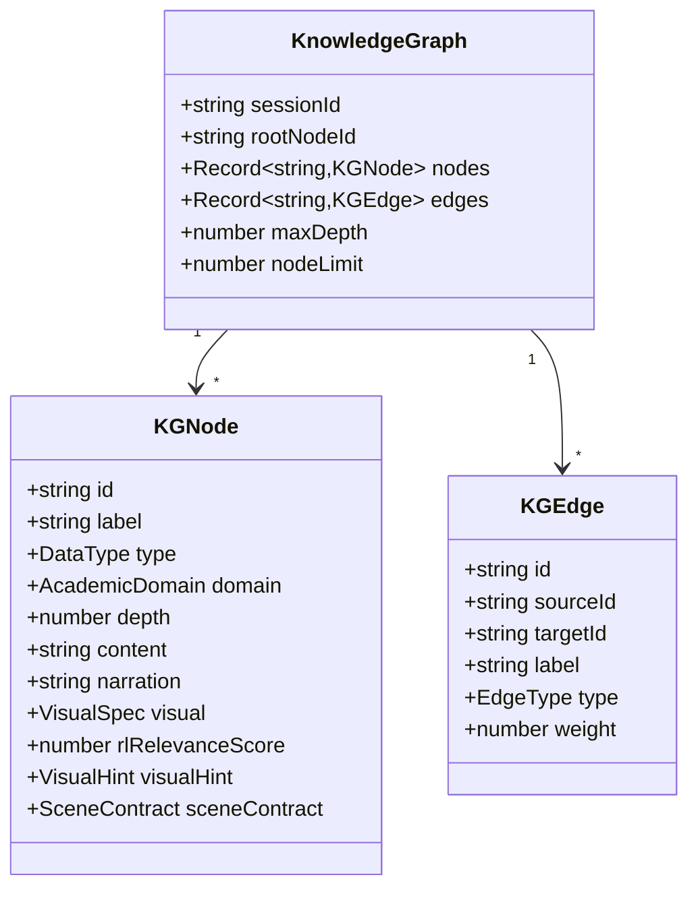

### 5.2 Data Type Classification (8 Semantic Types)

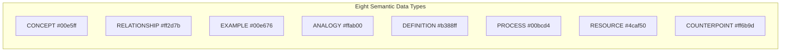

### 5.3 Session State Machine

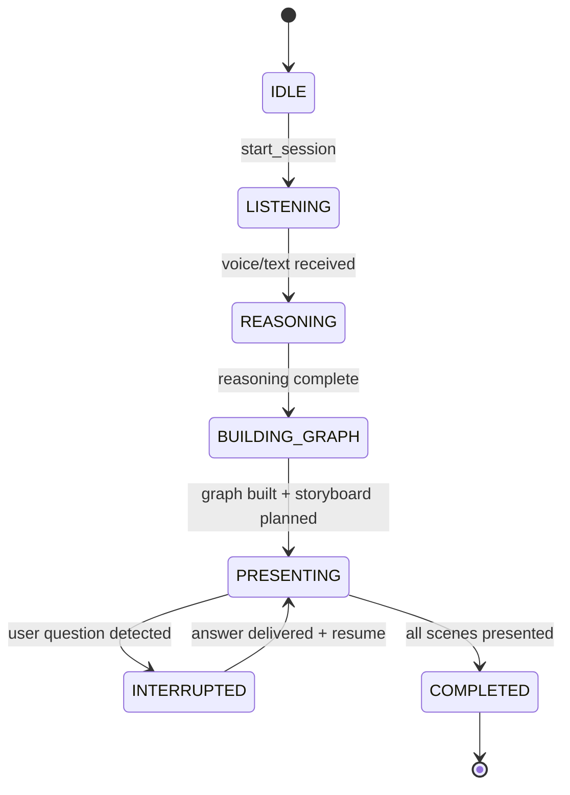

### 5.4 WebSocket Event Protocol

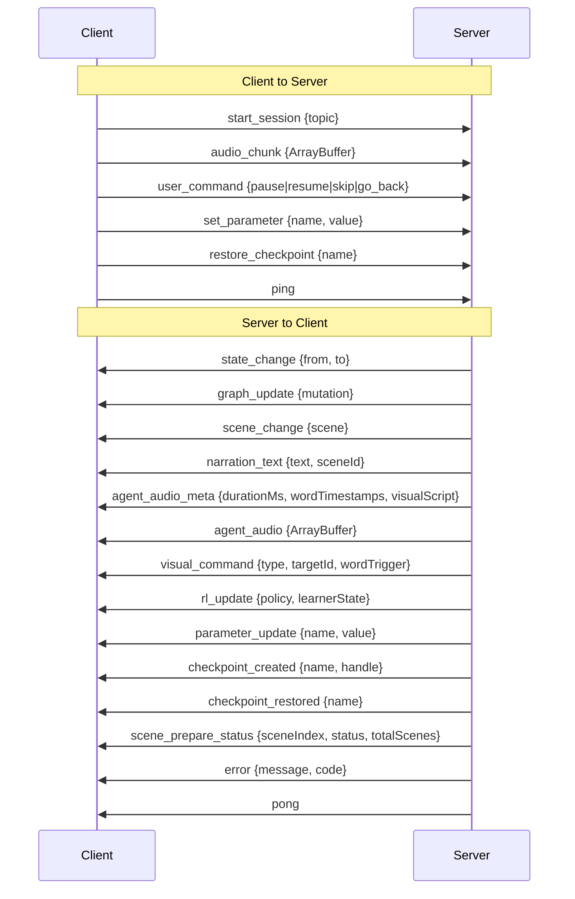

---

## 6. Backend Architecture

### 6.1 Entry Point & Server Initialization

`backend/src/index.ts` — Express HTTP server with WebSocket upgrade on `/ws`, REST at `/api`, health check at `/health`. Port defaults to 4000.

### 6.2 WebSocket Gateway

`backend/src/websocket/gateway.ts` — **Class: `WebSocketGateway`**

The central orchestrator. Routes messages, manages session state, drives the presentation lifecycle.

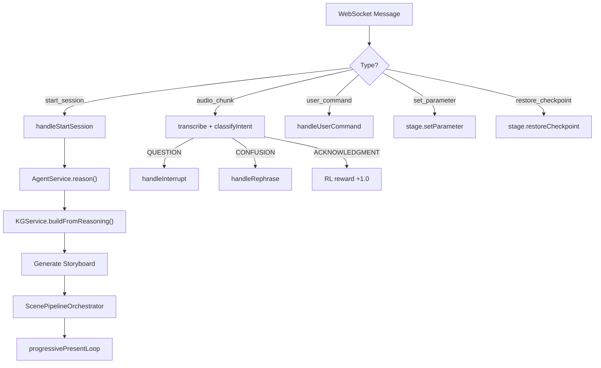

### 6.3 Agent Service (Claude AI)

`backend/src/services/AgentService.ts` — **Class: `AgentService`**

Three operations:

- **`reason(topic, rlPolicy)`** — Decompose topic into ReasoningOutput (nodes, edges, complexity gradient, follow-ups, scene contracts, visual hints)
- **`handleInterrupt(question, graph, currentNodeId, rlPolicy)`** — Reason about question in graph context, produce GraphMutation[] + PresentationScene[]
- **`rephraseNode(graph, nodeId, rlPolicy)`** — Alternate explanation strategy

All calls use Claude (`claude-sonnet-4-5-20250929`). Fallback mechanisms for API failures.

### 6.4 Multi-Agent Orchestrator

`backend/src/services/AgentOrchestrator.ts` — **Class: `AgentOrchestrator`**

Phase 2.5 blackboard pattern. Four agents collaborate per scene:

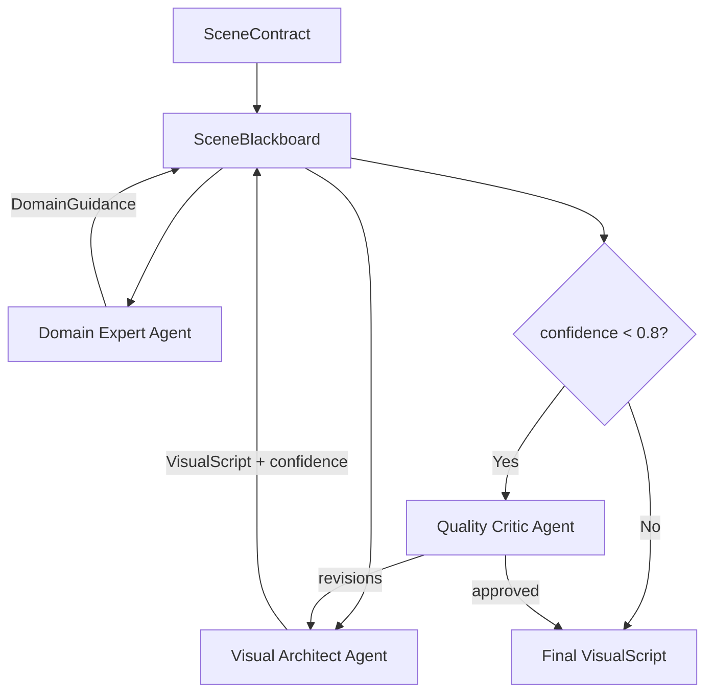

### 6.5 Knowledge Graph Service

`backend/src/services/KnowledgeGraphService.ts` — **Class: `KnowledgeGraphService`**

Two-phase construction:

- **Phase 1 (sync, depth 0-1):** Build core graph from ReasoningOutput before presentation starts
- **Phase 2 (async, depth 2-4):** Background expansion bounded by 50 nodes, prioritized by RL relevance

Graph mutation protocol: All changes flow through `GraphMutation` objects (`add_node`, `add_edge`, `update_node`, `remove_node`, `remove_edge`).

### 6.6 Voice Service

`backend/src/services/VoiceService.ts` — **Class: `VoiceService`**

- **STT:** Deepgram (nova-2) → transcript + word timestamps
- **TTS:** ElevenLabs (with_timestamps) → audio + character alignment → word-level sync
- **Intent Classification:** QUESTION, CONFUSION, ACKNOWLEDGMENT, COMMAND

VAD Config: 16kHz, 30ms frames, 800ms silence threshold, 200ms speech threshold.

### 6.7 Presentation Planner

`backend/src/services/PresentationPlanner.ts` — **Class: `PresentationPlanner`**

Transforms KG into scene sequence via BFS traversal weighted by RL relevance + policy expansion priority. Composes per-scene narration, visual commands, viewport, and estimated word timestamps.

### 6.8 Visual Script Generator

`backend/src/services/VisualScriptGenerator.ts` — **Class: `VisualScriptGenerator`**

Claude-driven frame-by-frame visual narrative generation. Segments narration semantically, maps to visual entities, choreographs animations, enforces timing constraints. Integrates with CodeExecutionService, DataVisualizationService, MathVisualizationService, AIIllustrationService.

### 6.9 Scene Pipeline Orchestrator

`backend/src/services/ScenePipelineOrchestrator.ts` — **Class: `ScenePipelineOrchestrator`**

Concurrent scene preparation: visual script generation + TTS synthesis run in parallel per scene, results fed into SceneReadyQueue for progressive consumption.

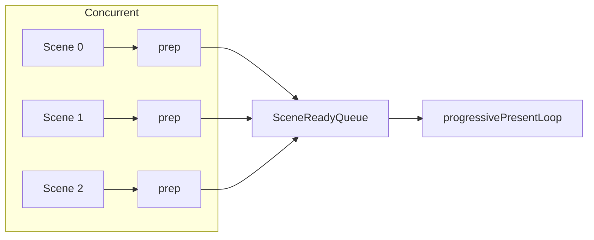

### 6.10 Supporting Services

| Service | Purpose |
|---------|---------|
| `InterruptHandler` | Bookmark creation, bridging phrases, resume narration |
| `ConcurrencyPool` | Bounded async executor (Claude: 5, TTS: 2, Total: 6) |
| `SceneReadyQueue` | Promise-based async queue for progressive presentation |
| `DomainExpertService` | Domain-specific visual guidance (math, physics, CS) |
| `QualityCriticService` | Contract compliance + quality review |
| `LayoutEngine` | Collision avoidance (force-based repulsion) |
| `SceneCompositionService` | Layout algorithms (force-directed, hierarchical, circular, grid, flow) |
| `CodeExecutionService` | Sandboxed Docker execution (8 languages) |
| `DataVisualizationService` | Chart generation (12 types) |
| `MathVisualizationService` | LaTeX rendering + function plotting |
| `AIIllustrationService` | AI image generation (DALL-E / Stable Diffusion) |
| `AdvancedAnimationService` | Particle, spring, cinematic animations |
| `AdvancedAudioService` | Spatial audio + soundscapes |
| `Interactive3DService` | Three.js visualization |
| `MemoryKnowledgeGraphService` | Cross-session learning memory |

### 6.11 REST API Routes

| Method | Endpoint | Description |
|--------|----------|-------------|
| `POST` | `/api/sessions` | Create session |
| `GET` | `/api/sessions/:id` | Get session state |
| `GET` | `/api/sessions/:id/graph` | Get knowledge graph |
| `GET` | `/api/users/:id/profile` | Get learner profile |
| `PUT` | `/api/users/:id/preferences` | Update preferences |
| `GET` | `/api/users/:id/sessions` | List session history |

### 6.12 System Prompts

- **`REASONING_SYSTEM_PROMPT`** — Knowledge architect decomposition with JSON schema, visual entity catalog, domain rules
- **`INTERRUPT_SYSTEM_PROMPT`** — Contextual question reasoning for graph mutations
- **`presentationEnvironmentGuide`** — SVG canvas spec, coordinate system, entity rendering rules

---

## 7. Frontend Architecture

### 7.1 Application Shell

`frontend/src/App.tsx` — Main React component. Layout: header, sidebar (info/graph/chat tabs), canvas area (ScenePresenter), timeline bar. Manages WebSocket connection, audio recording, visual command queue.

### 7.2 State Management

`frontend/src/stores/sessionStore.ts` — Single Zustand store with Immer.

Store slices: session state, knowledge graph, presentation scenes, audio state, visual state, RL state, chat. All WebSocket messages route through store actions. Reconnection: exponential backoff (1s → 30s max).

### 7.3 Canvas Rendering Pipeline

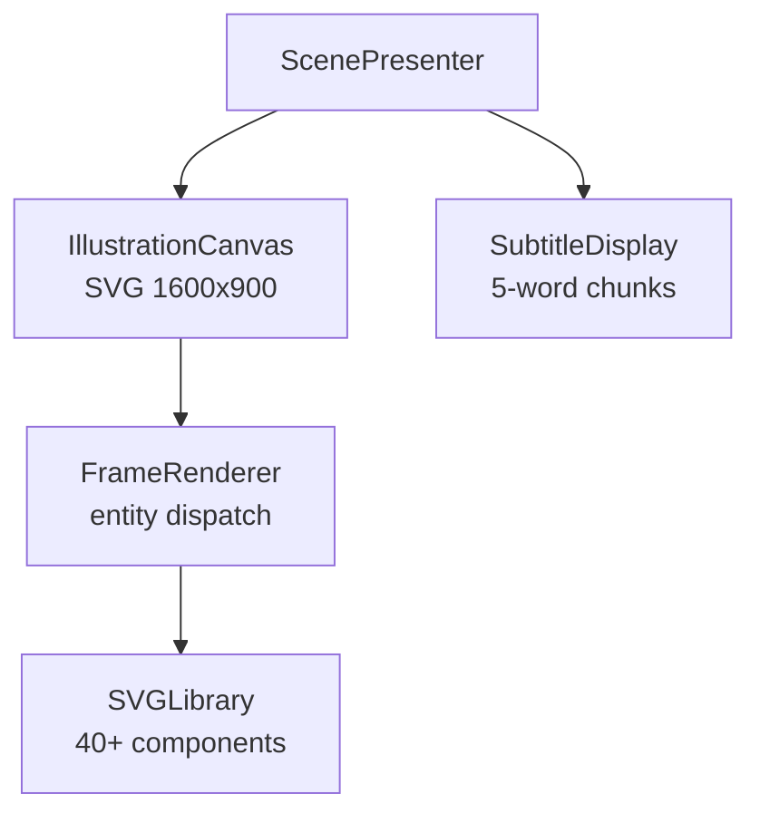

- Binary search for active frame at `currentAudioTime`
- Entity visibility filtered by animation delay
- Entity type dispatch to SVG components
- Scene transition state machine: RENDERING → FADING_OUT → CLEARED → RENDERING_NEW
- Fuzzy label matching for arrow source/target resolution

### 7.4 SVG Entity Library

40+ reusable SVG components: Server, Database, Container, Pod, Cloud, LoadBalancer, Firewall, APIGateway, Lambda, Equation, Matrix, Graph2D, Vector, Wave, Circuit, CodeBlock, StepList, Definition, BarChart, PieChart, VennDiagram, and more.

### 7.5 Audio Subsystem

- **AudioPlaybackManager:** TTS MP3 decode + scheduled playback + rAF time update loop
- **SoundEffectEngine:** Procedural Web Audio effects (reveal pop, connect ping, transition sweep, chime)

### 7.6 Demo Mode

`demoGraph.ts` — Embedded K8s knowledge graph (9 nodes, 9 edges, 5 scenes with visual scripts). Runs client-side only with auto-advance timers.

---

## 8. Core Pipelines

### 8.1 Session Lifecycle

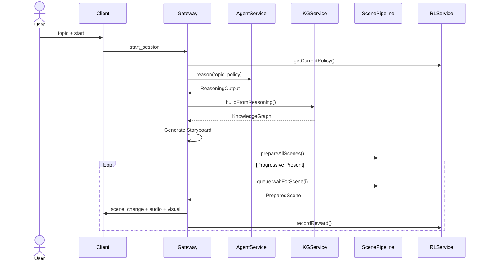

### 8.2 Concurrent Scene Preparation

For each scene in parallel:

1. `composeSceneLocals()` — sync scene composition
2. `AgentOrchestrator.orchestrateScene()` — multi-agent visual script (via ConcurrencyPool)
3. `VoiceService.synthesizeSpeech()` — TTS (via ConcurrencyPool)
4. Merge + rescale visual script timings to match real audio duration
5. `SceneReadyQueue.markReady(i)` — signal completion

Presentation starts as soon as scene 0 is ready. No waiting for all scenes.

---

## 9. Multi-Agent Coordination

Blackboard architecture with four specialized Claude agents per scene:

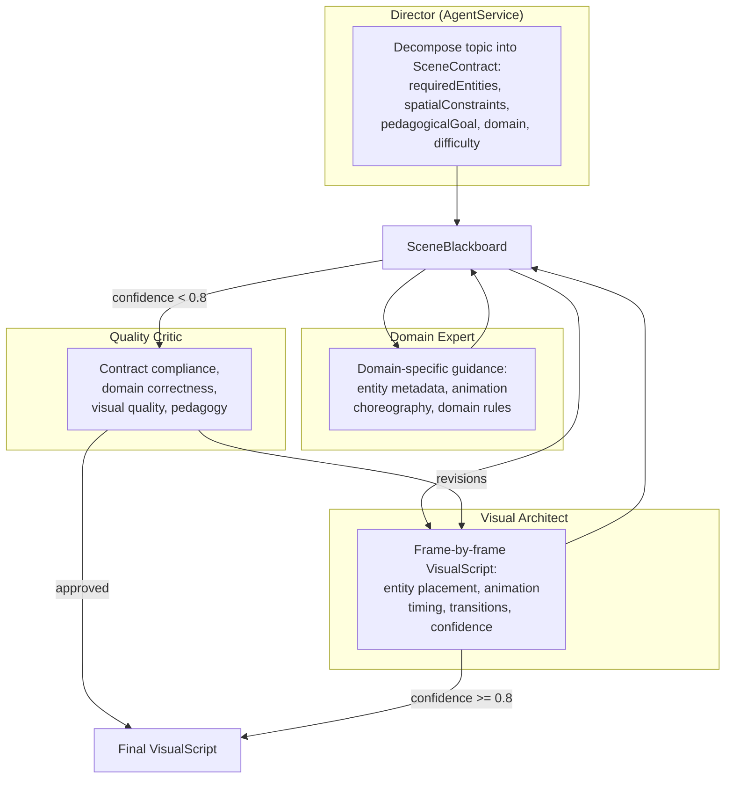

Max 1 revision per scene. If confidence remains low after revision, proceed with best effort.

---

## 10. RL Service — Journey Scope

### 10.1 Session-Level Adaptation (Current)

The existing RLService correctly implements Thompson Sampling for within-session adaptation:

- **State space (LearnerState):** avgTimePerNode, interruptRate, confusionRate, acknowledgmentRate, silenceDuration, expertiseLevel, preferredModality
- **Action space (RLPolicy):** explanationStrategy, pace, visualDensity, expansionPriority, comprehensionCheckFrequency
- **Rewards:** +1.0 acknowledgment, +1.5 deep question, -1.0 confusion, -0.5 silence, -0.3 revisit
- **Algorithm:** Contextual Bandit with Thompson Sampling (Beta distribution per arm)

This remains correct. Extend it with journey-level scope.

### 10.2 LearnerProfile (Cross-Session State)

```typescript
interface LearnerProfile {
  userId: string;

  // From roadmap platform (future integration)
  roadmapPosition: {
    roadmapId: string;
    currentConceptId: string;
    weekNumber: number;
    masteredConcepts: string[];
    struggledConcepts: string[];     // Used to anchor analogies
  };

  // Learned across ALL sessions, not just current
  presentationPreferences: {
    modalityPreference: 'visual-first' | 'verbal-first' | 'balanced';
    optimalPaceWPM: number;          // Converges via RL over sessions
    visualDensity: 'minimal' | 'moderate' | 'rich';
    bestExplanationStyle: 'analogy' | 'definition' | 'example' | 'process';
  };

  sessionHistory: SessionSummary[];
  thompsonSamplingState: BanditState;  // Persisted — not reset between sessions
}
```

### 10.3 Journey-Level Optimization

The Thompson Sampling state (`BanditState`) persists across sessions via `exportProfile()` / `importProfile()`. This means:

- A returning user's first scene already uses an informed policy (not random)
- Arm alpha/beta values accumulate over months of usage
- The system converges on each user's optimal teaching configuration

### 10.4 Mastery Write-Back Contract

A concept is considered mastered when:

- Zero confusion signals in the final 2 scenes of a concept explanation
- At least one acknowledgment signal (+1.0 reward) on the summary scene
- Session completion without revisiting the root node

Write-back fires as a REST call to the future roadmap platform API. In Phase 1: write to `LearnerProfile.masteredConcepts` only.

### 10.5 RL Feedback Loop

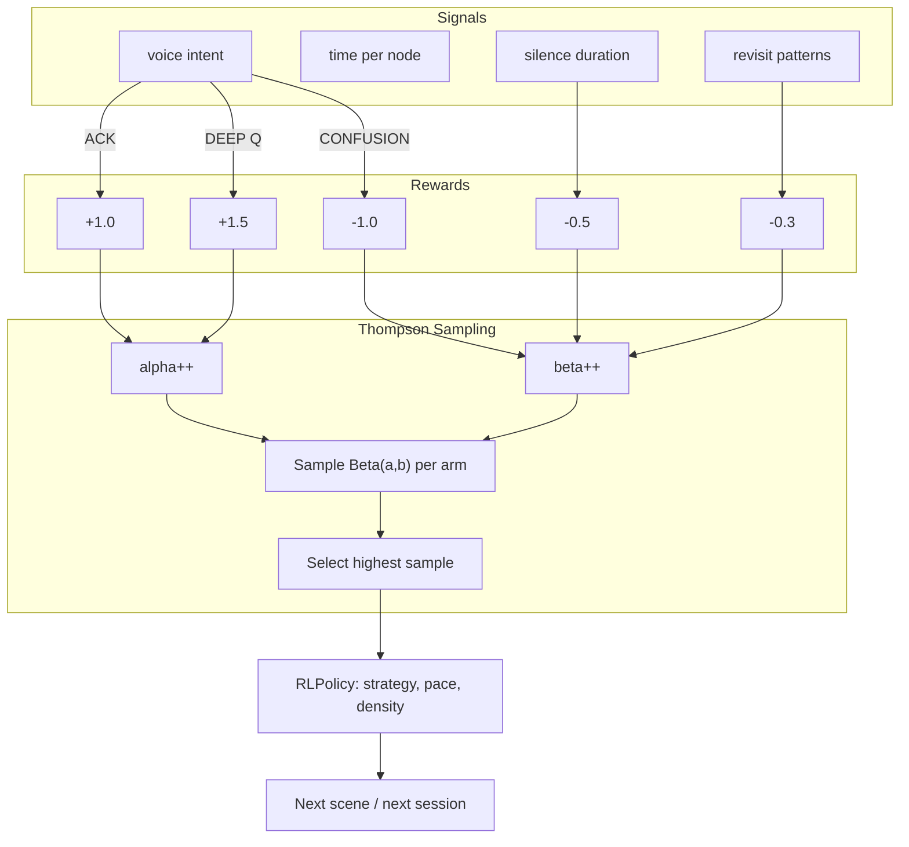

---

## 11. Interrupt Protocol

Five-step stateful interrupt handling:

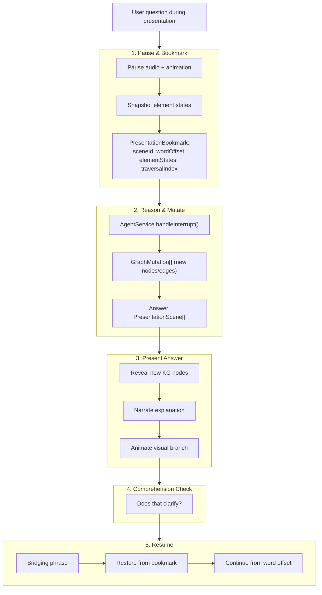

Latencies: interrupt detection <300ms, graph mutation <1s, resume <500ms.

---

## 12. Infrastructure & Deployment

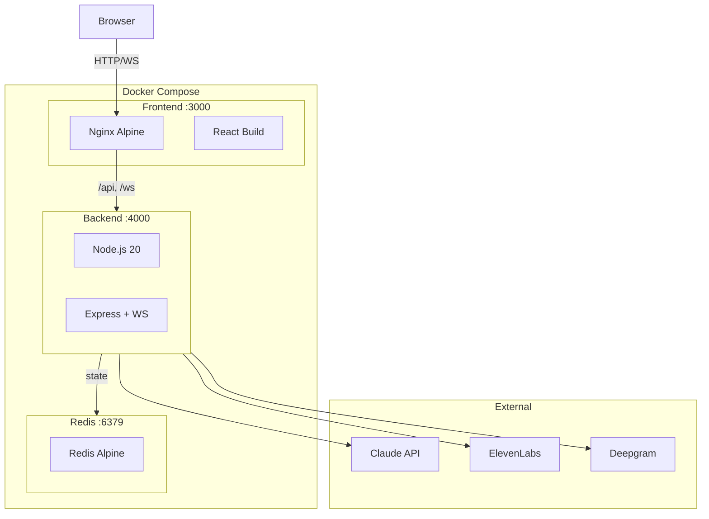

**Environment Variables:**

| Variable | Required | Default |
|----------|----------|---------|
| `ANTHROPIC_API_KEY` | Yes | — |
| `AGENT_MODEL_REASONING` | No | `claude-sonnet-4-5-20250929` |
| `AGENT_MODEL_FAST` | No | `claude-sonnet-4-5-20250929` |
| `ELEVENLABS_API_KEY` | No | — |
| `DEEPGRAM_API_KEY` | No | — |
| `REDIS_URL` | No | `redis://localhost:6379` |
| `PORT` | No | `4000` |

---

## 13. Performance Contracts

These are architectural laws exported from `shared/constants.ts`. Do not hardcode the numbers.

| Metric | Target | Constant Name |
|--------|--------|---------------|
| Voice to first spoken word | <2s | `VOICE_FIRST_WORD_MS` |
| Interrupt detection | <300ms | `INTERRUPT_DETECTION_MS` |
| Graph mutation on interrupt | <1s | `GRAPH_MUTATION_MS` |
| Resume from bookmark | <500ms | `BOOKMARK_RESUME_MS` |
| Visual sync accuracy | <100ms | `VISUAL_SYNC_ACCURACY_MS` |
| RL policy update | <50ms | `RL_UPDATE_INTERVAL_MS` |
| Checkpoint restore | <100ms | `CHECKPOINT_RESTORE_MS` |
| Parameter propagation | <16ms | `PARAMETER_PROPAGATION_MS` |
| Scene graph dirty render | <8ms | `SCENE_DIRTY_RENDER_MS` |
| Agent API command execution | <100ms | `AGENT_COMMAND_MS` |
| Storyboard generation | <5s | `STORYBOARD_GENERATION_MS` |

**Graph Constraints:**

| Parameter | Value | Constant |
|-----------|-------|----------|
| Max nodes | 50 | `KG_NODE_LIMIT` |
| Max depth | 4 | `KG_MAX_DEPTH` |
| Canvas | 1600 x 900 | `CANVAS_WIDTH`, `CANVAS_HEIGHT` |
| Voice sample rate | 16,000 Hz | `VOICE_SAMPLE_RATE` |
| Voice chunk size | 4,096 bytes | `VOICE_CHUNK_SIZE` |
| Min frame duration | 2,500ms | `FRAME_DURATION_MIN_MS` |
| Min animation delay | 150ms | `ANIMATION_DELAY_MIN_MS` |
| Min entity visible | 1,200ms | `ENTITY_MIN_VISIBLE_MS` |

**Concurrency Limits:**

| Pool | Max | Constant |
|------|-----|----------|
| Claude | 5 | `CONCURRENCY_POOL_CLAUDE_MAX` |
| TTS | 2 | `CONCURRENCY_POOL_TTS_MAX` |
| Total | 6 | `CONCURRENCY_POOL_TOTAL_MAX` |

All constants must be exported from `shared/constants.ts` and imported wherever the contract is enforced. Hardcoding any of these values in service code is a bug.
