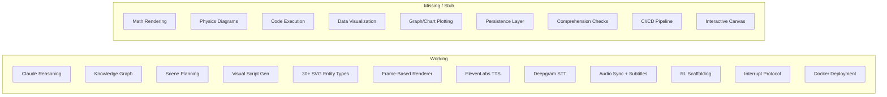
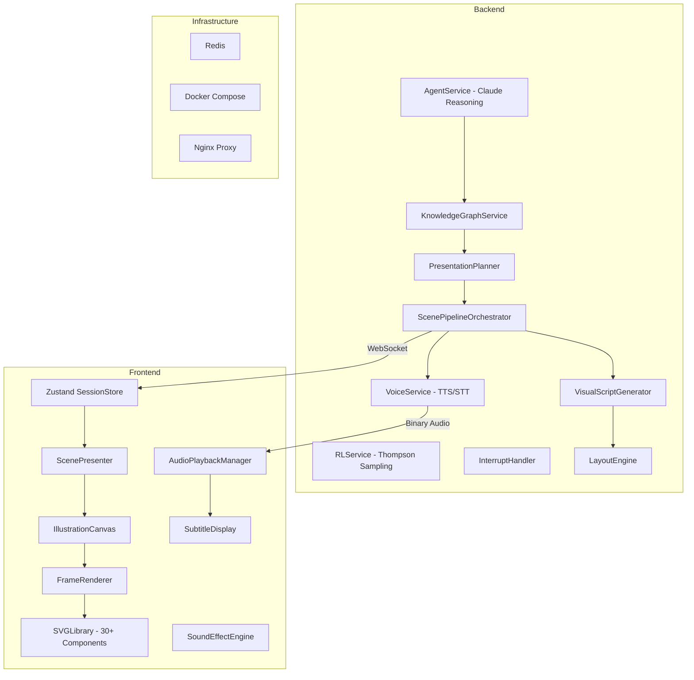
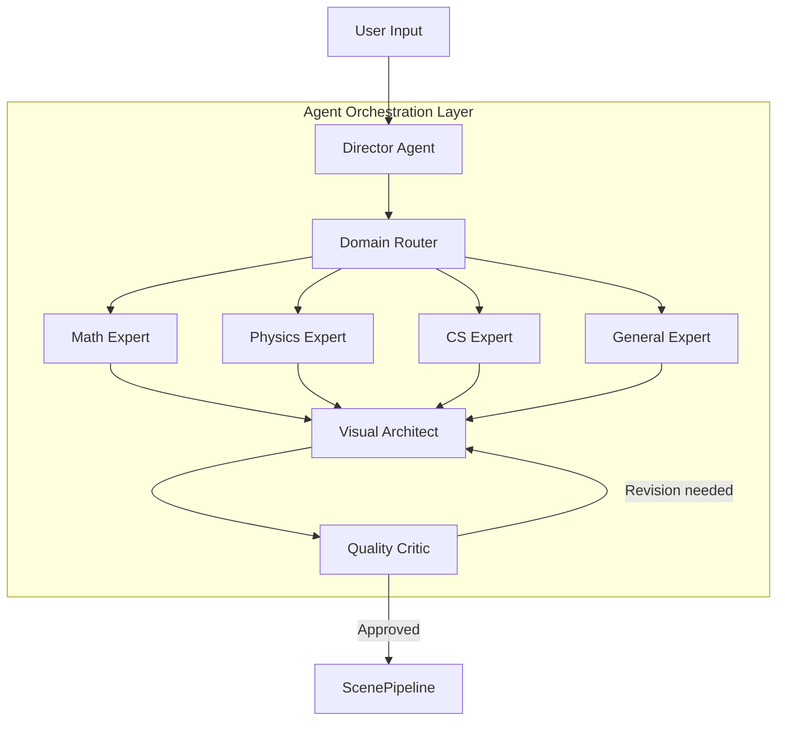
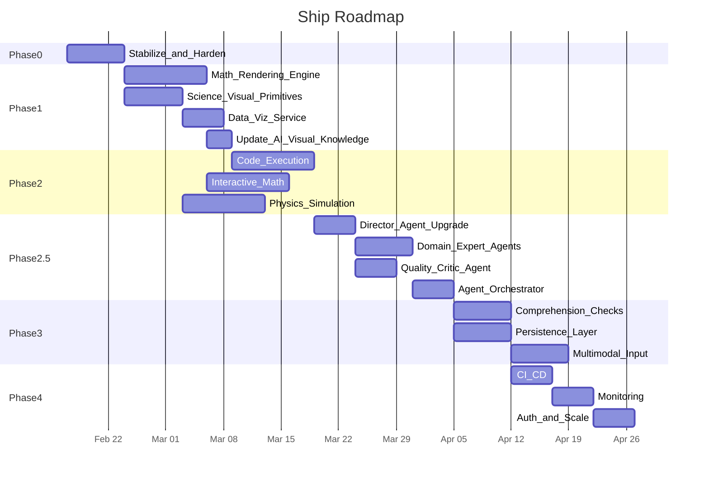

# Agentic Presentation System -- Ship Roadmap

> **Mission:** Build the first Agentic Presentation System -- an AI tutor that explains any topic with synchronized animated visuals, voice narration, and adaptive learning. Give humans the superpower of learning anything, at nearly the speed of light, with the easiest system possible.

---

## Where We Are Today

The project has a solid architectural skeleton. Here is what exists and works:



**Honest assessment:** The system can currently explain *IT infrastructure* topics with animated boxes, arrows, and labels. But the mission is to teach **math, physics, and any subject**. The visual vocabulary is heavily skewed toward tech diagrams, with zero support for equations, coordinate systems, geometric constructions, function plots, or scientific illustrations. This is the biggest gap between where we are and what we need.

### Architecture Overview



### What Works End-to-End

1. **Topic -> Knowledge Graph:** User enters a topic, Claude decomposes it into conceptual primitives with relationships
2. **Graph -> Scene Sequence:** Planner traverses the graph with RL-weighted ordering, producing scenes
3. **Concurrent Preparation:** Visual scripts and TTS audio are generated in parallel for each scene
4. **Progressive Delivery:** Scenes stream to the frontend as they become ready (no blocking)
5. **Synchronized Playback:** SVG entities animate in sync with voice narration via word timestamps
6. **Voice Interrupt:** User can ask questions mid-presentation; agent bookmarks, answers, resumes
7. **Adaptive Scaffolding:** RL policy adjusts pace, density, and explanation strategy

---

## Phase 0: Stabilize and Harden (1 week)

Fix what is broken or fragile so we have a reliable foundation to build on.

### Completed

- [x] **Position drift fix** -- Double-`<g>` structure in SVGLibrary separates positioning from CSS animations; deep-copy entities across frames to prevent mutation

### To Do

- [ ] **Frontend test framework** -- Wire up Vitest (already a dev dependency) with config in `frontend/vitest.config.ts`; port existing `entityPositionDrift.test.ts` to run via `npm test`
- [ ] **Error boundaries** -- Add React error boundaries in `App.tsx` around `ScenePresenter` and `Sidebar` so rendering failures don't crash the whole app
- [ ] **WebSocket reconnection** -- Add auto-reconnect with exponential backoff in `frontend/src/stores/sessionStore.ts` `connectWS()`; currently a disconnect kills the session permanently
- [ ] **Backend test gaps** -- Add basic integration tests for `AgentService.reason()` and `VoiceService` to catch regressions

### Key Files

- `frontend/src/components/svg/SVGLibrary.tsx` -- Double-`<g>` pattern (done)
- `frontend/src/components/FrameRenderer.tsx` -- Position/animation separation (done)
- `frontend/src/components/IllustrationCanvas.tsx` -- Deep-copy entities (done)
- `frontend/src/styles.css` -- Animation classes with `transform-origin`/`transform-box` (done)

---

## Phase 1: Universal Visual Vocabulary (2-3 weeks)

**This is the highest-priority phase.** The agent cannot teach math/physics if it can only draw servers and databases. We need a visual vocabulary that works for any subject.

### 1a. Math Rendering Engine

Add LaTeX-to-SVG rendering so the agent can display equations, expressions, and derivations.

- **New entity types** in `shared/types.ts`:
  - `Equation` -- LaTeX-rendered mathematical expression
  - `Expression` -- Inline math fragment
  - `Matrix` -- Matrix/determinant display
  - `Graph2D` -- 2D coordinate system with curves
  - `NumberLine` -- Annotated number line
  - `CoordinateSystem` -- XY grid with points, vectors, regions

- **Implement `MathVisualizationService`** (currently a stub at `backend/src/services/MathVisualizationService.ts`):
  - LaTeX to SVG conversion via `mathjax-node` or `KaTeX` server-side
  - Step-by-step equation animation (reveal terms progressively, highlight changes)
  - Function plotting (generate SVG `<path>` data for `f(x)` expressions)
  - Parametric curves and implicit functions

- **Frontend SVG components** in `frontend/src/components/svg/SVGLibrary.tsx`:
  - `EquationEntity` -- Renders LaTeX SVG with step animation
  - `Graph2DEntity` -- Axes, gridlines, curves, labels, annotations
  - `NumberLineEntity` -- Line with tick marks, labels, highlighted intervals
  - `CoordinateSystemEntity` -- 2D grid with plottable points and vectors

### 1b. Science and General Visual Primitives

Expand the entity types beyond IT infrastructure to serve physics, chemistry, biology, etc.

- **Physics entities:**
  - `FreeBodyDiagram` -- Object with force vectors
  - `Circuit` -- Basic electrical circuit elements
  - `Wave` -- Sinusoidal/standing wave visualization
  - `Vector` -- Labeled arrow with magnitude/direction
  - `Field` -- Vector field or scalar field visualization
  - `Particle` -- Point mass with trajectory

- **General purpose entities:**
  - `Table` -- Data table with header/rows
  - `Histogram` -- Frequency distribution bars
  - `PieChart` -- Proportional segments
  - `FlowDiagram` -- Generic flowchart
  - `VennDiagram` -- Overlapping set visualization
  - `Annotation` -- Callout with leader line

- **Implementation:** Same SVG component pattern as existing shapes in SVGLibrary
- **Update** `backend/src/prompts/presentationEnvironmentGuide.ts` to teach the agent about all new entity types -- when to use them, how to compose them, and how to animate them

### 1c. Data Visualization Service

Implement `backend/src/services/DataVisualizationService.ts` (currently a stub):

- Generate chart entities from structured data (bar, line, scatter, pie)
- Agent can say "here's how the data compares" and produce a chart entity
- Integrate with `VisualScriptGenerator` so Claude can emit data viz directives in visual segments
- Support animated data reveals (bars growing, lines drawing, segments appearing)

### 1d. Update the AI's Visual Understanding

The agent (Claude) needs to know about the new visual toolkit:

- **Expand the environment guide** (`presentationEnvironmentGuide.ts`) with math/science entity examples and composition patterns
- **Add domain-specific visual strategies:**
  - "When explaining derivatives, use a `Graph2D` with a tangent line animation"
  - "When explaining Newton's second law, use a `FreeBodyDiagram` with labeled force `Vector` entities"
  - "When comparing quantities, use a `Histogram` or `Table`"
- **Update `REASONING_SYSTEM_PROMPT`** to produce `visualHint` with appropriate `dataType` for math/science topics
- **Update `CLASSIFIER_SYSTEM_PROMPT`** to recognize academic content types (mathematics, physics, chemistry, biology, CS)

---

## Phase 2: Domain Engines (2-3 weeks)

Build specialized capabilities for the key domains.

### 2a. Code Execution Engine

Implement `backend/src/services/CodeExecutionService.ts` (currently a stub):

- Sandboxed code execution (Docker-in-Docker or WebAssembly sandbox like `wasm-sandbox`)
- Agent can generate and run code snippets during explanations
- Output captured and rendered as `CodeBlock` entities with syntax highlighting
- Support for Python, JavaScript, and pseudocode
- Critical for CS topics: algorithms, data structures, system design
- Safety: execution timeout, memory limits, no network access

### 2b. Interactive Math Solver

- Agent solves equations step-by-step, showing each algebraic transformation
- Each step = a visual frame with the `Equation` entity animating the change (highlight the modified terms, fade old expression, reveal new)
- Pipeline: Claude generates solution steps -> `MathVisualizationService` renders each step -> frames assembled into `VisualScript`
- Support for: algebra, calculus (derivatives/integrals), linear algebra, trigonometry

### 2c. Physics Simulation Primitives

- Simple particle/vector animations:
  - Projectile motion (parabolic trajectory)
  - Wave propagation (transverse/longitudinal)
  - Orbital mechanics (circular/elliptical paths)
  - Force equilibrium (spring, pendulum)
- Rendered as animated SVG paths with time-based interpolation
- Agent describes the physical scenario, simulation service generates the animation frames
- Parameters driven by the narration (e.g., "launch angle 45 degrees, initial velocity 20 m/s")

---

## Phase 2.5: Multi-Agent Intelligence (2-3 weeks)

**The system today is a single-agent pipeline.** One core agent (`AgentService`) makes all strategic decisions, and isolated services each fire a single Claude call with no feedback loop. This causes four fundamental problems:

1. **No self-correction** -- If the visual script call produces a bad layout, nothing catches it
2. **No domain specialization** -- The same generic prompt handles calculus, biology, and history
3. **No iterative refinement** -- Each Claude call is fire-and-forget, one shot
4. **No coordination** -- The reasoning agent suggests visual hints, but downstream services can override or ignore them

Phase 2.5 introduces a **4-agent cooperative architecture** that solves all four problems.

### Multi-Agent Architecture



### Agent 1: Director Agent (upgraded `AgentService.reason()`)

**Role:** High-level lesson planner and orchestrator.

- **What changes:** Instead of producing `visualHint` suggestions that downstream services may ignore, the Director produces a `SceneContract` -- a binding specification that includes mandatory entity types, spatial relationships between entities ("the Equation MUST be above the Graph2D"), and pedagogical intent per scene
- **Key file:** `backend/src/services/AgentService.ts`
- **New output type:** `SceneContract` with fields: `requiredEntities[]`, `spatialConstraints[]`, `pedagogicalGoal`, `domain`, `difficultyLevel`

### Agent 2: Domain Expert Agents (new `DomainExpertService`)

**Role:** Provide domain-specific visual guidance that the generic system cannot.

- **New file:** `backend/src/services/DomainExpertService.ts`
- **How it works:** A router dispatches to domain-specific system prompts based on `KGNode.domain`:
  - **Math Expert:** Knows that derivatives need tangent-line animations, integrals need shaded areas, matrices need row/column highlighting. Outputs precise `metadata` for math entities (LaTeX strings, expression syntax, coordinate ranges)
  - **Physics Expert:** Knows that F=ma needs a FreeBodyDiagram with correctly-angled force vectors, wave interference needs superposition visualization. Outputs force angles, trajectory parameters, field configurations
  - **CS Expert:** Knows that sorting algorithms need step-by-step array swaps, graph traversal needs node highlighting sequences
  - **General Expert:** Handles history, literature, business with appropriate Concept/Timeline/Comparison compositions
- **Output:** `DomainGuidance` -- enriched visual instructions including exact `metadata` values for each entity, spatial relationships, and animation choreography

### Agent 3: Visual Architect Agent (upgraded `VisualScriptGenerator`)

**Role:** Generate pixel-precise visual scripts using the Director's contract AND the Domain Expert's guidance as binding constraints.

- **Key file:** `backend/src/services/VisualScriptGenerator.ts`
- **What changes:**
  - Receives both `SceneContract` and `DomainGuidance` as input (not just narration + dataType)
  - `SceneContract.spatialConstraints` replace the current situation where Claude suggests positions and `LayoutEngine` overrides them -- constraints become first-class inputs
  - Domain Expert's `metadata` values are passed through to entities instead of being generated generically
  - Falls back to current behavior if no contract/guidance is available (backward compatible)

### Agent 4: Quality Critic Agent (new `QualityCriticService`)

**Role:** Review visual scripts before they reach the renderer. Catch errors. Request revisions.

- **New file:** `backend/src/services/QualityCriticService.ts`
- **Evaluation criteria:**
  1. **Contract compliance:** Does the script include all `requiredEntities` from the Director's contract? Are spatial constraints satisfied?
  2. **Domain correctness:** Is the math LaTeX valid? Are physics vectors at reasonable angles? Are chart data values consistent with narration?
  3. **Visual quality:** Are entities overlapping? Is there enough visual variety? Are animations staggered properly?
  4. **Pedagogical alignment:** Does the visual sequence match the narration flow? Is the primary concept visually prominent?
- **Output:** Either `{ approved: true }` or `{ approved: false, revisions: [...] }` with specific fix instructions
- **Revision loop:** If not approved, the Visual Architect gets one retry with the revision feedback (max 1 retry to bound latency). If the retry also fails, the original script is used with a warning logged

### Shared Blackboard (agent communication)

All four agents read and write to a shared `SceneBlackboard` per scene:

```typescript
interface SceneBlackboard {
  sceneId: string;
  contract: SceneContract;        // Director writes
  domainGuidance: DomainGuidance; // Domain Expert writes
  visualScript: VisualScript;     // Visual Architect writes
  criticReview: CriticReview;     // Critic writes
  revisionCount: number;
  finalScript: VisualScript;      // Approved output
}
```

This replaces the current one-way data flow with a shared context that enables agents to reference each other's outputs.

### Pipeline Integration

The multi-agent flow integrates into `ScenePipelineOrchestrator.prepareScene()` via a new `AgentOrchestrator` (`backend/src/services/AgentOrchestrator.ts`):

1. **Director** already ran during `handleStartSession` -- `SceneContract` is attached to each `PresentationScene`
2. **Domain Expert** runs (1 Claude call, ~500 tokens) -- produces `DomainGuidance`
3. **Visual Architect** runs (1 Claude call, ~1500 tokens) -- produces `VisualScript`
4. **Quality Critic** runs (1 Claude call, ~500 tokens) -- approves or requests revision
5. If revision needed: **Visual Architect** runs again (1 more Claude call, max 1 retry)

**Cost per scene:** 3-4 Claude calls instead of 1 (bounded). The existing `ConcurrencyPool` handles rate limiting.

### Latency Mitigation

- Domain Expert and Critic use the fast model with small `max_tokens` (500-800)
- Critic review is skipped for scenes where the Visual Architect's confidence score exceeds a threshold
- The existing `ConcurrencyPool` handles parallel execution across scenes -- extra calls per scene are sequential but scenes remain parallel
- Expected added latency: ~2-3s per scene (acceptable given TTS already takes ~2s)

### Implementation Checklist

- [ ] Define `SceneContract`, `DomainGuidance`, `CriticReview`, `SceneBlackboard` types in `shared/types.ts`
- [ ] Upgrade `AgentService.reason()` to output `SceneContract` per conceptual primitive
- [ ] Create `DomainExpertService` with Math/Physics/CS/General expert prompts
- [ ] Create `QualityCriticService` with evaluation criteria and revision output
- [ ] Create `AgentOrchestrator` to coordinate the 4-agent flow per scene
- [ ] Update `ScenePipelineOrchestrator.prepareScene()` to use `AgentOrchestrator`
- [ ] Update `VisualScriptGenerator` to accept `SceneContract` + `DomainGuidance` as inputs
- [ ] Modify `LayoutEngine` to respect `spatialConstraints` from `SceneContract` instead of overriding positions
- [ ] Add confidence scoring to `VisualScriptGenerator` output to allow Critic bypass
- [ ] Add telemetry: log Critic approval rate, revision rate, revision success rate

---

## Phase 3: Learning Loop and Interaction (2 weeks)

Turn the system from a one-way presenter into an interactive tutor.

### 3a. Comprehension Checks

The RL service already has `shouldCheckComprehension()` but it is never exercised:

- **Pause-and-quiz:** Agent pauses narration, poses a question on the canvas, waits for voice/text answer
- **Answer evaluation:** Agent evaluates correctness and adjusts RL policy (record reward signal)
- **Adaptive frequency:** RL policy controls how often checks happen (already scaffolded in `RLService`)
- **Implementation:** Extend `InterruptHandler` for agent-initiated pauses (it already supports bookmark/resume flow)
- **New WebSocket event:** `comprehension_check` with question text and expected answer type

### 3b. Learner Model Persistence

- Add PostgreSQL or SQLite for session persistence
- **Store:**
  - Session history (topic, duration, scenes presented)
  - Learner profile (preferences, pace, difficulty level)
  - RL arm parameters (Beta distribution alphas/betas per strategy)
  - Knowledge graph snapshots (what was taught, what was understood)
- **Enable:** "Continue where you left off" across sessions
- **Analytics:** Store anonymized learning signals for system improvement

### 3c. Multi-Modal Input

Implement `backend/src/services/MultimodalInputService.ts` (currently a stub):

- Accept image uploads (photo of homework, whiteboard, textbook page)
- Use Claude's vision capability to extract problems/content from images
- Generate a presentation that solves/explains the captured content
- Frontend: drag-and-drop or camera capture UI
- Pipeline: image -> Claude vision -> structured problem -> knowledge graph -> presentation

---

## Phase 4: Production Readiness (1-2 weeks)

### 4a. CI/CD Pipeline

- GitHub Actions workflow:
  - Lint (ESLint for both backend and frontend)
  - Type check (TypeScript strict mode)
  - Test (backend Jest + frontend Vitest)
  - Build Docker images
  - Deploy to staging/production
- Automated PR checks with coverage thresholds (70% branches, 75% functions, 80% lines)

### 4b. Monitoring and Observability

- Structured logging with correlation IDs (backend)
- Health dashboard:
  - API latency percentiles
  - TTS/STT success rates and latency
  - WebSocket connection counts and message throughput
  - Scene preparation pipeline metrics
- Error tracking (Sentry or equivalent)
- Alerting on error rate spikes

### 4c. Performance Optimization

- Concurrent scene preparation -- tune `ConcurrencyPool` sizes based on load testing
- Frontend: lazy-load SVG components by domain, virtualize large knowledge graphs
- CDN for static assets (fonts, base SVG templates)
- WebSocket message batching for high-frequency updates

### 4d. Authentication and Multi-Tenancy

- User accounts (JWT + OAuth with Google/GitHub)
- Session isolation (each user gets their own Redis namespace)
- Rate limiting per user (prevent API key abuse)
- Usage tracking and quotas

---

## Phase 5: Differentiation Features (ongoing)

These are the features that make the system magical, built after the core is solid.

- **Collaborative mode:** Multiple learners in one session, shared canvas, individual RL profiles
- **AI-generated illustrations:** Use image generation models (DALL-E, Stable Diffusion) for photorealistic diagrams when SVG is insufficient (implement `AIIllustrationService`)
- **3D visualizations:** WebGL/Three.js layer for molecular structures, 3D geometry, spatial reasoning
- **Adaptive pacing:** Feed RL policy with real engagement signals -- response latency, quiz scores, time-on-concept
- **Curriculum planning:** Multi-session learning paths with prerequisite tracking and spaced repetition
- **Export:** Generate PDF/video recordings of presentations for offline review
- **Mobile app:** Responsive design + PWA or native wrapper for mobile learning
- **Offline mode:** Pre-generate common topic presentations for low-connectivity environments

---

## Recommended Execution Order



---

## Key Insight

The architecture is strong. The concurrent scene pipeline, the RL scaffolding, the interrupt protocol, the frame-based visual system -- these are genuinely sophisticated. Two critical investments remain:

**Phase 1 (Universal Visual Vocabulary) gives the agent the tools.** Once it can render equations, plot functions, draw force diagrams, and animate state transitions for *any* domain, the rendering pipeline works for every subject. The hardest part of "explain anything visually" is the "visually" part.

**Phase 2.5 (Multi-Agent Intelligence) gives the agent the brain.** Today the system is a single-agent pipeline: one Claude call plans the lesson, another generates visuals, and nothing checks the result. The multi-agent architecture adds domain specialization (a math expert that knows derivatives need tangent-line animations), quality assurance (a critic that catches bad layouts before the user sees them), and coordination (a binding contract between what the planner intended and what the renderer produces). Without this, the agent has tools but no judgment.

The good news: the frame-based rendering pipeline (`VisualScript` -> `IllustrationFrame` -> `FrameRenderer` -> `SVGLibrary`) is designed to be extensible, and the `ConcurrencyPool` + `ScenePipelineOrchestrator` already support the parallel execution patterns that multi-agent coordination requires.

**Ship Phase 0+1, and you have a demo that can teach math. Ship Phase 2.5, and you have an agent that teaches well. Ship through Phase 3, and you have a product.**
